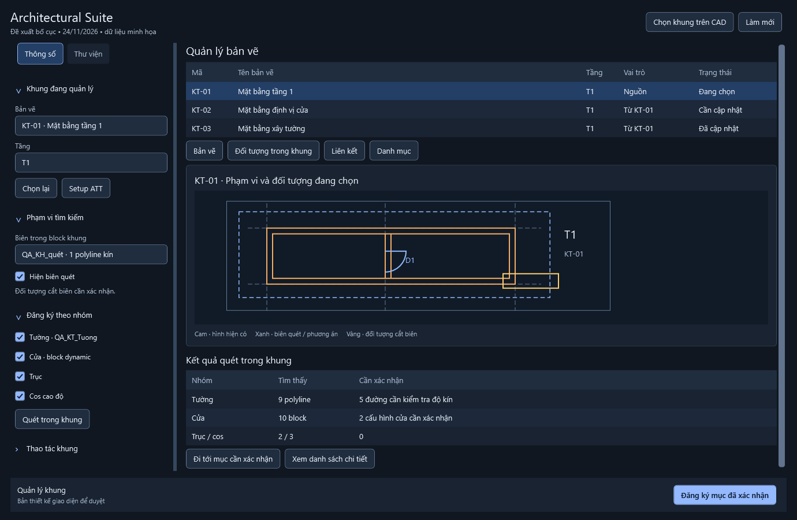
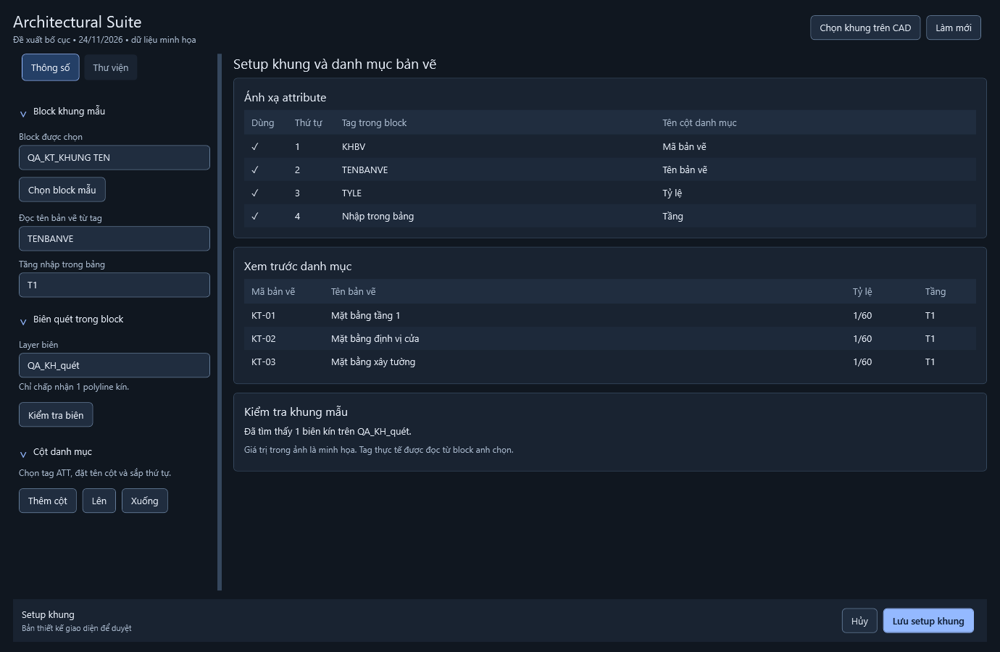
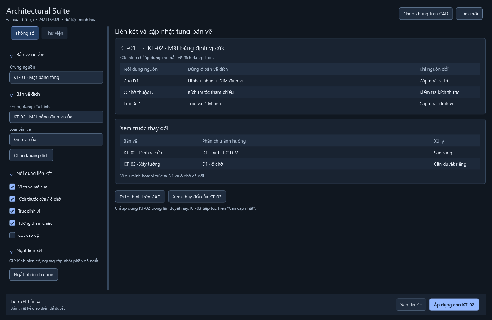
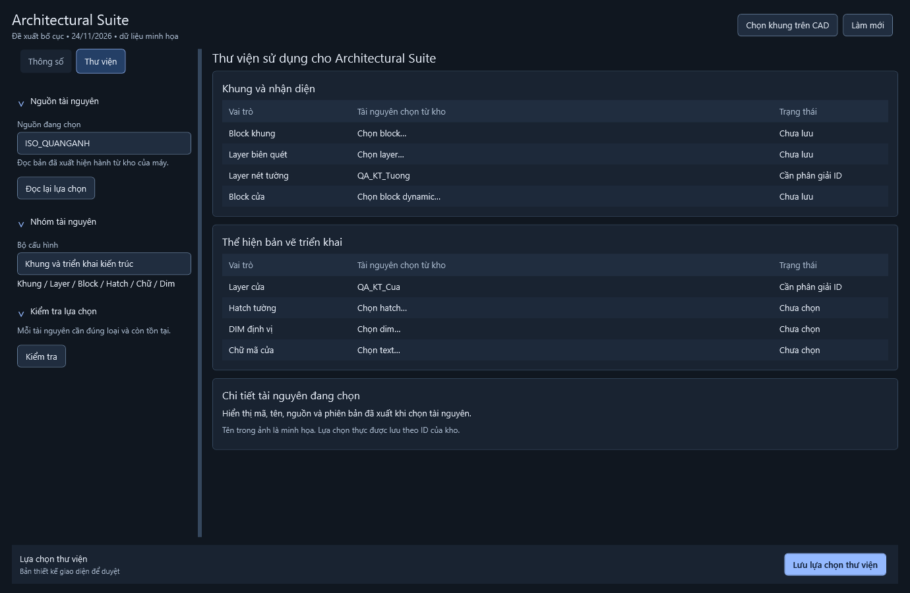

# KẾ HOẠCH XÂY DỰNG ADD-IN ARCHITECTURAL SUITE

**Tài liệu:** `PLAN_Architectural_Suite_v0.1.md`  
**Phiên bản:** 0.1 – Đề xuất kiến trúc và kế hoạch triển khai  
**Ngày:** 21/11/2026  
**Nền tảng mục tiêu:** AutoCAD 2021, C#/.NET Framework 4.8, x64  
**Căn cứ:** `PLAN_Autocad_v0.2.md` và bộ tài liệu trong `Quy Tac Trien Khai Addin`  
**Trạng thái ngày 21/11/2026.** Manager đã chọn Architectural Suite 0.2.0, build `90655f7a4b06`, với một nút `QAARCHOPEN`. Palette bố trí thao tác theo nhóm, có chọn vùng nguồn, kiểm kê, duyệt gợi ý, đăng ký tường/cửa, tra cứu và định vị, chọn tài nguyên kho, tạo hai mặt bằng, bảng thống kê, xem trước và duyệt cập nhật, xử lý xung đột, xuất CSV/JSON và dựng lại chỉ mục SQLite. Kiểm thử Core Console trên DWG tổng hợp đã kiểm tra liên kết, diện tích trừ cửa, sửa rộng cửa, bảo vệ nét chỉnh tay, lưu/mở lại, Undo/Redo và nhập tài nguyên kho. Đã mở Palette hai lần trong AutoCAD đồ họa và xác nhận một instance. Cần người triển khai duyệt quy tắc nhận diện, điểm neo cửa, bố trí ký hiệu và tỷ lệ trên mặt bằng công trình đại diện. Hướng dẫn sử dụng ở `src/Arch.Suite.Host/README.md`.

**Bổ sung đã thống nhất ngày 21/11/2026:** tên Architectural Suite, ưu tiên đăng ký hình có sẵn, duyệt trước khi đồng bộ, bảo vệ chỉnh sửa tay và hai tiện ích kiểm tra MVP tại mục 2.1–2.3.

---

## Điều chỉnh ngày 24/11/2026 — Quản lý bản vẽ theo khung

**Architectural Suite** quản lý mỗi bản vẽ qua một khung block. Người dùng đăng ký khung nguồn, ví dụ mặt bằng tầng 1, rồi chỉ định biên quét tương ứng. Một cách tổ chức đề xuất là đặt biên trong layer `QA_KH_quét`. Khung block định danh bản vẽ, còn biên quét xác định phạm vi tìm nội dung. Tên layer chính thức, cách tìm biên thuộc từng khung và cách xử lý đối tượng cắt biên sẽ chốt ở bước đầu.

Trong phạm vi đã xác định, add-in tự tìm ứng viên tường, cửa, trục và cos cao độ theo quy tắc của từng nhóm. Có thể bổ sung nhóm đăng ký khác. Hiển thị kết quả và trường hợp mơ hồ trước khi người dùng xác nhận đăng ký. Quét lại phải nhận ra đối tượng đã đăng ký để tránh trùng và cho phép truy ngược về khung và thực thể CAD.

**Giao diện lấy add-in Trục (Axis) làm mẫu.** Palette có bảng điều khiển bên trái và vùng nội dung quản lý bên phải. Bên trái chọn khung, quét, đăng ký nhóm, sinh bản vẽ và điều khiển đồng bộ. Bên phải hiển thị danh sách khung, phạm vi, đối tượng đăng ký và tình trạng các bản vẽ liên kết. Có tab **Thư viện** riêng ngay trong Palette Architectural Suite để chọn nguồn/profile và tài nguyên theo vai trò, gồm block khung, layer, block ký hiệu, hatch và kiểu kích thước cần dùng.

### Từ mặt bằng gốc đến bản vẽ triển khai

| Khung gốc | Khung triển khai | Ví dụ nhóm nội dung có thể chọn liên kết |
|---|---|---|
| Mặt bằng T1 | Mặt bằng định vị cửa | Cửa, trục, tường/ô chờ tham chiếu và thông số định vị. |
| Mặt bằng T1 | Mặt bằng xây tường | Tường, trục, ô chờ và thông số kích thước. |
| Mặt bằng T1 | Mặt bằng sàn | Vùng sàn, cốt cao độ, vật liệu và thành phần tham chiếu được chọn. |

Mỗi khung đích lưu ID khung nguồn và danh sách nhóm nội dung hoặc thuộc tính được liên kết. Người dùng có thể xem, thêm hoặc bỏ lựa chọn riêng cho từng bản vẽ. Khi nguồn hoặc lựa chọn liên kết thay đổi, add-in xác định phần chịu ảnh hưởng, hiển thị Preview và cho Apply/Skip theo từng bản vẽ. Ví dụ dời cửa cập nhật hình định vị. Mặt bằng xây tường chỉ bị ảnh hưởng nếu ô chờ liên kết cũng đổi. Ghi chú thủ công và nội dung ngoài liên kết được bảo toàn theo chính sách hiện hành. Cách xử lý hình đã sinh khi bỏ liên kết sẽ được chốt trước khi triển khai.

### Thứ tự thảo luận và triển khai

| Bước | Phạm vi | Cần chốt trước khi chuyển bước |
|---|---|---|
| **1. Quản lý khung và biên quét** | Khung block, mã/tầng/loại bản vẽ, biên quét, bố cục Axis và tab Thư viện. | Chọn một khung T1 làm mẫu. Xác định được biên đúng, cách xử lý thiếu hoặc nhiều biên và nội dung hiển thị ở hai vùng Palette. |
| **2. Đăng ký từng nhóm trong khung** | Thảo luận riêng quy tắc tường của người dùng, sau đó là cửa, trục, cos cao độ và các nhóm khác. | Có ví dụ nhận đúng, trường hợp mơ hồ và dữ liệu bắt buộc cho từng nhóm. |
| **3. Giao tường–cửa** | Xác định tường chủ, ô chờ và giao hình học. | Chốt điểm neo và dung sai, cách xử lý cửa sát đầu tường, tại giao tường hoặc có nhiều tường ứng viên. |
| **4. Sinh khung và nội dung triển khai** | Sinh từ T1 lần lượt mặt bằng định vị cửa, xây tường và mặt bằng sàn. | Chốt đầu vào, cách thể hiện và mức tự động hóa của từng mặt bằng. Hai đầu ra cửa/xây thuộc MVP hiện tại. Mặt bằng sàn thuộc lộ trình mở rộng, chờ chốt quy tắc sàn. |
| **5. Điều chỉnh liên kết và đồng bộ theo bản vẽ** | Quản lý cấu hình nguồn–đích, Preview và Apply/Skip theo từng khung. | Thử hai khung có lựa chọn liên kết khác nhau. Sửa nguồn chỉ tác động đúng các phần được chọn. |

**Quy tắc tường cần bàn với người dùng:** layer/kiểu nét, điều kiện để ghép hai mặt thành một tường, đường chuẩn, bề dày và xử lý đoạn đứt hoặc giao nhau. Dùng quy tắc do người dùng xây dựng.

**Định nghĩa cửa cần bàn riêng:** cách nhận block/nét/nhãn, mã cửa, kích thước, điểm đặt, hướng mở, phân biệt bộ cửa với ô chờ. Quy tắc giao tường–cửa được duyệt riêng ở bước 3.

**Trạng thái.** Đây là cập nhật kế hoạch. Việc tiếp theo là trao đổi bước 1 về mẫu khung T1, biên quét và màn hình Axis tham chiếu. Các quy tắc nghiệp vụ chưa bàn sẽ được ghi nhận ở từng bước trước khi sửa code.

---

## Quyết định và đề xuất tiếp theo ngày 24/11/2026

### Các quyết định người dùng đã chốt

1. Cho chọn block khung mẫu. Đọc tên bản vẽ từ attribute đã cấu hình. Tên tầng nhập trong bảng quản lý. Có bảng setup chọn các tag attribute và sắp thứ tự để dùng cho danh mục bản vẽ.
2. Mỗi khung có đúng một biên quét hình chữ nhật hoặc polyline nằm trong block khung. Khi áp dụng cần kiểm tra biên khép kín và xác định theo vị trí/biến đổi của lần chèn khung.
3. Đối tượng cắt biên đưa vào danh sách xác nhận. Có thao tác zoom/highlight tới đối tượng để người dùng điều chỉnh cho nằm trọn trong khung rồi quét lại.
4. Khi bỏ liên kết, giữ lại hình đang có. Ý nghĩa cụ thể của hình sau khi ngắt liên kết cần theo đề xuất dưới đây để người dùng duyệt.
5. Phần sàn bàn sau. Hiện tập trung khung, tường, cửa và liên kết.
6. Tường dùng hình có thể chỉnh trực tiếp. Cửa dùng các lần chèn block dynamic riêng. Add-in quản lý nhóm trong phạm vi khung.

### Xử lý khung — đã được người dùng duyệt

- Phân biệt thao tác bố trí lại cả bản vẽ và thao tác chỉnh riêng khung/biên. Di chuyển hoặc xoay cả bản vẽ bằng công cụ của Suite sẽ áp dụng cùng phép biến đổi cho khung, đối tượng đã đăng ký và ghi chú được người dùng chọn kèm. Dùng hệ tọa độ cục bộ của mặt bằng để việc bố trí lại không bị hiểu thành dời từng cấu kiện trong thiết kế.
- Nếu người dùng chỉ Move/Rotate khung bằng lệnh CAD gốc, giữ hình nội dung tại vị trí người dùng đã đặt, báo phạm vi cần xác nhận và cho chọn chỉnh riêng khung hoặc bố trí lại toàn bộ. Chốt tập đối tượng trước khi quét lại và cập nhật quan hệ.
- Copy để tạo bản triển khai nên qua lệnh Sinh bản vẽ. Copy tạo mặt bằng nguồn/tầng mới cần xác nhận mã/tầng, cấp danh tính mới và xác lập liên kết theo lựa chọn. Copy khung bằng lệnh CAD gốc tạo khung chờ đăng ký.
- Chưa chốt cách hỗ trợ khung scale không đều và mirror. Các trường hợp này phải có quy tắc đơn vị, tỷ lệ và chiều trước khi công bố hỗ trợ.

### Đề xuất định nghĩa tường — chờ người dùng duyệt

- Profile tường chọn layer nét tường, các bề dày chấp nhận và dung sai. Bản đầu xét các mặt tường thẳng từ Line hoặc đoạn thẳng Polyline.
- Ghép hai mặt song song có khoảng cách phù hợp và phần chiều dài tương ứng. Tạo đoạn tường logic gồm đường chuẩn, hai mặt, bề dày, đầu/cuối và các thực thể nguồn.
- Tại lỗ cửa, dùng quan hệ cửa đã xác nhận để nối logic các đoạn tường cùng phương. Chỗ L/T/X, tường đổi dày, nhiều cặp song song hoặc thiếu mặt tường cần hiển thị đề xuất cho người dùng duyệt.
- Chiều cao tường nhập theo tầng/loại với khả năng ghi đè từng đoạn. Thiếu chiều cao vẫn có thể đăng ký vị trí và chiều dài, còn diện tích/khối lượng yêu cầu dữ liệu đầy đủ.
- V1 cần chốt cách đo chiều dài và xử lý giao tường để bóc khối lượng không tính chồng.

### Đề xuất cửa dynamic và quan hệ tường–cửa — chờ người dùng duyệt

- Setup theo từng loại block để ánh xạ dynamic property chiều rộng. Xác nhận property đang biểu thị rộng bộ cửa, ô chờ hay thông thủy, cùng đơn vị và trường hợp chèn scale.
- Chiều cao ưu tiên property chiều cao nếu block có và đã được ánh xạ. Nếu block chỉ thể hiện mặt bằng, dùng bảng loại cửa theo mã do người dùng khai báo (ví dụ D1 cao 2.200 mm), cho ghi đè từng bộ và ghi nguồn giá trị. Có thể ánh xạ attribute chiều cao nếu block có.
- Kích thước bộ cửa và ô chờ lưu riêng. Độ chừa lắp đặt theo loại do người dùng chốt. Cần cốt chân/bậu để xác định vị trí ô theo phương đứng.
- Ánh xạ điểm neo, hướng dọc cửa và vị trí hai mép ô cho từng loại block, bao gồm trường hợp flip. Tìm tường ứng viên trong cùng khung dựa trên hướng, khoảng cách tới đường chuẩn, bề dày và vị trí hai mép.
- Một tường phù hợp duy nhất thì đề xuất gắn. Nhiều tường, vị trí giao, cửa sát đầu tường hoặc không khớp chiều dày thì yêu cầu chọn/xác nhận.
- Xem trước ô chờ trước khi sinh hình. Dùng hợp các phần ô thực sự nằm trong vùng tính của tường để trừ khối lượng, xử lý ô trùng và nhiều bộ cửa dùng chung ô một lần. Quy tắc đo và phần giao tường phải chốt riêng.

### Ngắt liên kết — đã được người dùng duyệt

Giữ hình và ghi chú hiện tại, đánh dấu phần ngắt là độc lập/ngừng nhận cập nhật từ nguồn. Giữ dấu vết nguồn cũ để tra cứu, loại biểu diễn đó khỏi tập cấu kiện nguồn dùng đếm khối lượng. Khi nối lại phải xem trước khác biệt và chọn cách hợp nhất. Cần phân biệt ngắt một nhóm thuộc tính với ngắt toàn bộ bản vẽ.


### Bổ sung về tường và cửa — đang thống nhất

Người dùng duyệt các đề xuất khác trong phần quyết định ngày 24/11/2026. Quy tắc tường và cửa tiếp tục thảo luận. Những mục scale không đều/mirror và hành vi nghiệp vụ còn ghi là chưa chốt vẫn cần có quy tắc trước khi hỗ trợ.

**Yêu cầu mới của người dùng.** Nhận tường theo các nét khép kín thuộc layer tường đã chọn. Cần tính đủ phần tường trên cửa. Khi chèn cửa vào tường, hình tường tự ngắt tại ô cửa. Khi xóa block cửa, hình tường tự nối lại.

**Phương án đề xuất để thảo luận.** Lưu biên tường đầy đủ đã đăng ký cùng cao độ đáy/đỉnh làm dữ liệu nguồn. Các đoạn hoặc vùng tường nhìn thấy sau khi ngắt là hình biểu diễn từ biên đầy đủ và các ô chờ còn hiệu lực. Bộ tính khối lượng dùng biên đầy đủ với chiều cao và trừ các ô chờ đúng cao độ. Phần tường nằm trên đỉnh ô vẫn được tính theo quy tắc đo. Khi có lanh tô riêng, cần chốt cách phân loại/trừ phần kết cấu đó khỏi khối lượng xây.

- Lần đầu đăng ký cần phân biệt biên tường liên tục với các mảng đã cắt sẵn quanh cửa. Với mảng đã cắt, phải xác nhận đường bao liên tục hoặc quan hệ qua ô trước khi có thể phục hồi chính xác khi xóa cửa.
- Chèn cửa có tường chủ xác định duy nhất thì thêm ô chờ, dựng lại hình tường tại vùng ảnh hưởng. Dời hoặc kéo rộng cửa thì cập nhật ô cũ và ô mới. Cửa ở chỗ giao hoặc có nhiều tường ứng viên cần xác nhận.
- Xóa cửa thì cập nhật các ô chờ và tái dựng từ biên nguồn cùng các ô còn lại. Nhiều bộ dùng chung ô chờ cần chính sách giữ/xóa ô riêng để không lấp mất cửa còn tồn tại. Trường hợp ô chờ giữ lại sau khi bỏ bộ cửa cần thao tác riêng.
- Thao tác ngắt/nối trên hình nguồn là yêu cầu tự động sau khi thao tác CAD kết thúc thành công. Cần thiết kế Undo/Redo, lệnh hủy và lưu/mở lại tương ứng. Các bản vẽ phụ thuộc vẫn theo cơ chế Preview/Apply đã duyệt.
- Hình tường bị chỉnh tay sau khi ngắt phải được đối soát với biên nguồn trước khi tái dựng, để giữ đúng ý đồ sửa thiết kế.

**Ví dụ kiểm tra đề xuất.** Tường dài 4 m, cao 3 m, dày 0,2 m, ô chờ rộng 1 m và cao 2,1 m từ chân tường. Theo phép đo hình học đơn giản, diện tích một mặt còn 9,9 m² và thể tích còn 1,98 m³. Trong đó dải trên ô rộng 1 m, cao 0,9 m vẫn có diện tích 0,9 m² trước khi phân loại phần lanh tô riêng.

Cần chốt tiếp hình thức biên tường khép kín thực tế, cao độ đáy/đỉnh, cách đọc mép ô từ block dynamic và quy tắc xử lý lanh tô. Đây là phương án thiết kế, chưa triển khai code.


## Thiết kế bản cập nhật ArchitecturalSuite — xem trước ngày 24/11/2026

**Trạng thái** Đề xuất bố cục để người dùng duyệt trước khi sửa mã ứng dụng. Bản đang được catalog chọn tại lần đối chiếu này là `Arch.Suite.Host 0.2.0`, build `90655f7a4b06`, Manager ID `b40fc389e1784687b8e85403c213c024`, lệnh mở `QAARCHOPEN`. Bản cập nhật tính năng dự kiến dùng phiên bản 0.3.0 sau khi chốt phạm vi; các ảnh ở đây là bản thiết kế, chưa đại diện cho một build mới.

### Căn cứ và yêu cầu tích hợp

Đã đọc lại AGENTS, ADDIN-UI-STANDARD, ADDIN-MANAGER-STANDARD, ADDIN-DEVELOPMENT-WORKFLOW, LIBRARY-CONSUMER-STANDARD, RESOURCE-IDENTIFIERS và TEST-ARTIFACT-LIFECYCLE trong bộ Quy Tac Trien Khai Addin. Đối chiếu thêm theme và AxisDialogLayout trong repo AI-CAD-MCP, QA-RESOURCE-WORKFLOW, cấu hình kho của máy, catalog đang chọn, hướng dẫn Architectural Suite 0.2.0 và quy trình phát triển trong kho.

- Một nút do CAD Tool Manager quản lý, mở một Palette ổn định của Architectural Suite. Tái sử dụng theme Axis, Segoe UI, control dark, nhóm thu gọn và hai vùng co kéo. Bảng trái mặc định gọn khoảng 280 DIP, có thể co kéo với giới hạn tối thiểu đề xuất 240 DIP và lưu chiều rộng theo máy.
- Hai tab chính bên trái là **Thông số** và **Thư viện**. Nút chính và thông báo cố định dưới cùng. Thao tác chọn/quét/xem trước chỉ đọc; đăng ký và áp dụng là thao tác ghi rõ ràng.
- Cấu hình sử dụng kho lưu theo Manager ID thật ở `Catalog/addin-settings/<ManagerToolId>.json`, dùng `SourceId + Kind + Id`, giữ ID dạng chuỗi đầy đủ để QA nhận diện. Nạp lại lựa chọn sau khi QA xóa/gộp, kiểm tra bản đã xuất, hash và nguồn chưa hoàn tất trước khi triển khai.
- Cấu hình nhận dạng nghiệp vụ thuộc Suite. QA quản lý tài nguyên gốc. Setup tag ATT, biên quét và property cửa không ghi đè định nghĩa thư viện chung.
- Khi sửa mã sẽ đối chiếu nguồn Git, schema đang có, cơ chế Manager và dữ liệu DWG cũ. Gói phát triển theo `_Development/Arch.Suite.Host`, giữ GUID Palette và Manager ID; cập nhật qua Manager sau khi kiểm tra. Các minh họa WPF chưa thay thế nghiệm thu trong AutoCAD GUI và DPI thực tế.

### Bốn màn hình xem trước

**Quản lý khung.** Trái chọn khung/tầng, hiển thị biên, chọn nhóm quét và thao tác bố trí khung. Phải có bảng các bản vẽ, nội dung theo khung đang chọn, preview phạm vi và bảng kết quả quét. Có Đi tới mục cần xác nhận và nút Đăng ký mục đã xác nhận. Chuyển sang danh sách đối tượng để xem từng handle và lý do cần duyệt. Chọn CAD và chọn trong bảng hỗ trợ định vị hai chiều.



**Setup khung và danh mục.** Chọn block mẫu, ánh xạ tag tên bản vẽ và các cột ATT; tầng nhập trong bảng. Cho bật/tắt cột, đặt tên, đổi thứ tự và xem ngay bảng danh mục. Kiểm tra đúng một biên kín trong block. Nội dung không vừa màn hình sẽ cuộn, nút Lưu setup giữ ở dưới.



**Liên kết bản vẽ.** Trái chọn nguồn/đích và nhóm nội dung liên kết. Phải hiển thị quan hệ và thay đổi cần áp dụng. Duyệt từng khung; khung khác còn thay đổi tiếp tục giữ trạng thái cần cập nhật. Ngắt liên kết giữ hình và ngừng nhận cập nhật theo phạm vi đã chọn. Các checkbox nhóm sẽ mở chi tiết thuộc tính khi quy tắc tương ứng đã được chốt.



**Thư viện.** Tab riêng của Suite cho chọn tài nguyên theo vai trò. Bộ chọn thực tế cần tìm theo mã/tên và hiển thị nguồn, phiên bản, trạng thái liên kết. Ảnh chỉ minh họa danh sách vai trò, các ô Chọn là vị trí bộ chọn tương tác khi triển khai.



Hình mặt bằng, trạng thái và số liệu trong ảnh phục vụ duyệt bố cục. Kiểm tra file FileMauTuong cho thấy 9 polyline cấp Model trên QA_KT_Tuong, gồm 4 Closed và 5 chưa Closed. Số cửa và số cảnh báo trong mockup là minh họa.

### Phạm vi cập nhật cần thực hiện lần lượt sau khi duyệt bố cục

1. **Vỏ giao diện, khung, ATT và biên.** Chọn mẫu, đọc ATT, nhập tầng, duyệt danh sách khung và phạm vi. Thư viện có lựa chọn đã lưu và kiểm tra liên kết theo chuẩn hiện hành.
2. **Quét và đăng ký.** Dùng profile layer tường và vùng đường bao. Polyline hở hiển thị cần xác nhận. Phân biệt nét tường trong block cửa với vùng tường ngoài block. Các nhóm cửa dynamic, trục và cos bổ sung theo quy tắc đã chốt.
3. **Tường–cửa và ô chờ.** Giữ vùng tường đầy đủ và cao độ để tính cả phần trên cửa; hình mặt bằng là kết quả từ vùng tường và ô chờ. Tự ngắt/nối khi chèn, dời, thay rộng và xóa cửa sau khi thao tác hợp lệ hoàn tất. Xử lý Undo/Redo và chỉnh tay; điểm neo, ánh xạ property và lanh tô cần chốt chi tiết. Đây là phần tự cập nhật hình nguồn. Các bản vẽ đích tiếp tục duyệt theo từng khung.
4. **Sinh và đồng bộ từng bản vẽ.** Tạo mặt bằng định vị cửa và xây tường, cấu hình phần liên kết, xem trước và áp dụng. Quản lý bản gốc/biểu diễn để tính khối lượng không đếm lặp. Sàn sẽ bàn riêng.
5. **Kiểm soát và khối lượng.** Hoàn thiện danh mục ATT, báo liên kết và số liệu truy nguồn, kiểm thử toàn luồng và bàn giao gói theo chuẩn Manager.


### Quy tắc đã chốt — bảo vệ nội dung liên kết và đồng bộ một chiều

- Nội dung đang liên kết trên bản vẽ triển khai chỉ được đọc, chọn và tra cứu. Các thao tác sửa hình học, thuộc tính, di chuyển riêng, xóa, explode hoặc sửa định nghĩa dùng chung làm đổi nội dung liên kết cần được bảo vệ.
- Chỉnh thiết kế tại bản vẽ gốc. Bản vẽ triển khai chỉ nhận cập nhật từ nguồn qua cơ chế đồng bộ và duyệt theo từng khung đã thống nhất. Chính sách này áp dụng cho các phần được chọn liên kết.
- Nội dung ngoài liên kết và ghi chú bổ sung độc lập có thể chỉnh theo quyền thông thường. Khi ngắt liên kết có xác nhận, giữ hình hiện tại và chuyển phần đó sang độc lập; ngừng nhận cập nhật từ nguồn.
- Nếu dữ liệu đã bị sửa qua thao tác ngoài cơ chế bảo vệ, đánh dấu sai lệch và yêu cầu đồng bộ lại từ nguồn. Hình sửa ở bản triển khai không được trở thành nguồn thiết kế. Cần xem trước trước khi tái dựng để xử lý an toàn dữ liệu hiện có.
- Thiết kế cơ chế bảo vệ đối tượng theo phạm vi liên kết. Cần kiểm thử khi cùng layer có cả hình liên kết và ghi chú độc lập, khi sửa block definition, copy/paste, chuyển khung, Undo/Redo và lưu/mở lại.
- Giao diện hiển thị trạng thái “Liên kết — chỉ đọc”, có “Đi tới bản gốc” và “Đồng bộ từ bản gốc”. Cấu hình lựa chọn liên kết vẫn được điều chỉnh trong bảng.
- Đây là yêu cầu cho bản cập nhật sắp triển khai; cơ chế bảo vệ và giao diện cần được viết và kiểm thử trên AutoCAD.

### Bố cục trái gọn và dữ liệu khi tiếp tục công việc

**Bố cục đã điều chỉnh theo yêu cầu.** Bảng trái mặc định gọn, đề xuất 280 DIP và có thể thu đến khoảng 240 DIP nếu nội dung vẫn đọc được. Người dùng kéo thanh chia để mở rộng khi cần; lần mở sau nhớ chiều rộng gần nhất theo máy. Các nhóm có thể thu gọn và cuộn dọc, thao tác chính cố định dưới cùng. Khi DPI thay đổi cần nghiệm thu thực tế. Bộ ảnh xem trước đã cập nhật chiều rộng mặc định này.

**Dữ liệu công trình phải đi cùng DWG.** Trong bản hiện tại, Model.Load/Save đọc và ghi mô hình vào Xrecord ARCH_SUITE_V1 trong Named Objects Dictionary. Các cấu kiện lưu thông số, quan hệ và handle; danh sách hình sinh/bảng và revision nằm cùng mô hình. ProjectIndex dựng SQLite tại LocalAppData/ArchitecturalSuite/Index từ dữ liệu DWG.

Bản cập nhật cần tiếp tục nguyên tắc này và mở rộng dữ liệu DWG cho khung/biên, tầng, ánh xạ ATT và thứ tự danh mục áp dụng cho công trình, đối tượng đã đăng ký, vùng tường đầy đủ, ô chờ, cấu hình liên kết riêng từng bản vẽ, revision/trạng thái và thông tin tài nguyên đã dùng. Ghi thay đổi hợp lệ vào DWG trong transaction; nhắc người dùng lưu file khi còn dữ liệu chưa lưu. Bản đã lưu là mốc phục hồi khi mở lại.

| Nơi lưu | Nội dung | Khi chuyển máy |
|---|---|---|
| DWG công trình | Hình CAD, dữ liệu công trình và các liên kết nội bộ đã lưu. Giữ thông tin cấu hình/tài nguyên áp dụng cho công trình và phiên bản dữ liệu. | Chuyển toàn bộ DWG sẽ mang dữ liệu này theo. Máy đích dùng Suite tương thích để đọc và làm tiếp. |
| Kho QA | Tài nguyên gốc và lựa chọn mặc định của Suite tại Catalog/addin-settings theo Manager ID. | Máy đích cấu hình kho có các ID/asset cần thiết để tạo hoặc cập nhật nội dung phụ thuộc tài nguyên. |
| Dữ liệu cục bộ theo máy | Chiều rộng bảng, nhóm thu gọn, bộ lọc và index/cache có thể dựng lại. | Khởi tạo lại giao diện và dựng lại index từ DWG. |

Cấu hình dùng cho công trình và lựa chọn mặc định trong kho cần được phân biệt. Thay lựa chọn mặc định không tự ghi đè cấu hình công trình đang mở. Khi người dùng yêu cầu dùng lựa chọn mới, cần kiểm tra tài nguyên, xem trước và lưu lại cấu hình áp dụng trong DWG. Bản ghi tài nguyên trong DWG dùng để truy vết; việc tạo mới phải xác minh tài nguyên hiện còn hợp lệ trong kho theo chuẩn QA.

**Tắt máy và mở lại.** Sau khi lưu DWG, mở lại phải nạp được danh sách khung, đăng ký, liên kết và trạng thái từ file. Các lựa chọn còn ở bản nháp chưa xác nhận phải được hiển thị rõ. AutoSave/recovery có thể là đường phục hồi khi sự cố nhưng không thay cho thao tác Save.

**Chuyển bản vẽ.** Gửi/copy nguyên file DWG đã lưu khác với COPYCLIP/WBLOCK một phần nội dung sang DWG khác. Luồng chuyển một phần cần ánh xạ lại đối tượng và định danh, phải kiểm thử riêng. Save As dùng làm bản tiếp tục cần giữ quan hệ nội bộ; khi biến bản sao thành dự án mới cần thao tác xác nhận danh tính. Tài nguyên ngoài DWG như Xref/ảnh/font, nếu có, cần được chuyển kèm.

Bản hiện tại đã có lưu mô hình trong DWG. Lưu nhiều khung, setup ATT, cấu hình liên kết mới và cơ chế phục hồi mở rộng vẫn là yêu cầu cho bản cập nhật, cần kiểm thử Save/Close/Open và trên máy khác.


### Đã triển khai bước quản lý khung — ứng viên 0.3.0

Bản cập nhật đã có Palette mật độ gọn với bảng trái mặc định 260 DIP, thu đến 220 DIP, co kéo và nhớ chiều rộng theo máy. Hàng dữ liệu 27 DIP, control thông thường khoảng 28 DIP, ưu tiên vùng preview. Hai tab chính Thông số/Thư viện và các tab nội dung Phạm vi/đối tượng, Setup ATT, Danh mục. Dữ liệu 0.2 giữ trong tab riêng để làm tiếp hồ sơ cũ.

Đã có chọn block khung, kiểm tra đúng một biên kín trong block, khai báo tầng, setup ATT/thứ tự cột, lưu nhiều khung trong DWG, quét ứng viên, định vị đối tượng, pan/zoom preview và xuất danh mục CSV. Cấu hình mới lưu tại ARCH_SUITE_FRAMES_V1; mô hình ARCH_SUITE_V1 được giữ nguyên.

Kiểm thử Core Console 2021 đạt với khung dịch/xoay/scale đều, tường hở/cắt biên, nạp lại layer biên, thứ tự ATT, lưu/copy DWG/mở phiên mới, dữ liệu 0.2 và biên lỗi. WPF đã render có dữ liệu ở hai kích thước cửa sổ. AutoCAD GUI mở hai lần giữ một Palette. Chưa nghiệm thu đầy đủ thao tác chuột và DPI trong GUI, chưa chuyển sang máy vật lý thứ hai và chưa cài ứng viên qua Manager.

Gói trong kho theo đường dẫn tương đối Tools/dotnet/_Development/Arch.Suite.Host/versions/0.3.0/build-06945ee7b56d. Catalog vẫn chọn 0.2.0. Hướng dẫn và giới hạn chính xác nằm trong README nguồn và NOTES của gói. Bước tiếp theo là đăng ký vùng tường/cửa dynamic, sau đó tự ngắt/nối tường và liên kết từng khung. Bộ chọn profile khung và cấu hình mặc định kho cũng cần mở rộng trước khi bàn giao toàn bộ luồng mới.

### Ghi nhận phản hồi giao diện và đăng ký hàng loạt — 24/11/2026

**Phạm vi lượt ghi nhận** Cập nhật yêu cầu và phân tích lỗi theo ảnh người dùng gửi. Chỉ sửa tài liệu kế hoạch.

| Nội dung | Điều chỉnh cần triển khai |
|---|---|
| Nút góc trên phải và nút Lưu khung/setup vượt mép Palette | Sửa bố trí header/footer theo kích thước vùng khách thực của Palette, padding và DPI. Khi thiếu chiều ngang cần wrap hoặc đổi bố cục để nút nằm trọn vùng bấm. Nút chính cố định dưới cùng; không chỉ che phần tràn bằng clipping. Kiểm tra trực tiếp trên AutoCAD GUI khi dock, kéo hẹp/rộng và đổi DPI. |
| Lặp lựa chọn mẫu khung, tag tên và layer biên | Có profile khung được lưu, gồm nhận diện block mẫu, tag tên bản vẽ, layer biên và setup cột ATT/thứ tự. Cấu hình áp dụng cho công trình lưu trong DWG để mở lại hoặc chuyển file vẫn dùng tiếp. Các giá trị cụ thể của mỗi khung và tên tầng vẫn quản lý riêng. |
| Chọn nhiều khung cùng lúc | Thêm thao tác Quét chọn khung trên CAD, hỗ trợ quét vùng/chọn nhiều block theo profile đã lưu. Hiển thị danh sách khung ứng viên ngay trong bảng trước khi lưu; kiểm tra tag, đúng một biên kín và trùng đăng ký cho từng khung. Khung lỗi có lý do riêng; người dùng xác nhận tập hợp lệ để đăng ký. Cho nhập tầng hàng loạt hoặc sửa từng dòng. |
| Phần định nghĩa tường chưa hoạt động theo quy tắc đã chốt | Bản 0.3 mới quét ứng viên trên layer tường. Cần triển khai setup nhận vùng tường Polyline kín và thao tác đăng ký thật vào mô hình, lưu/mở lại, truy ngược và thông báo rõ số tường đã đăng ký. Đường hở/cắt biên cần xác nhận. Công cụ hai Line 0.2 là luồng cũ, không đại diện cho đăng ký vùng tường mới. |
| Tab Thư viện báo Kho đang đồng bộ và không mở được bộ chọn | Bổ sung thông báo có nguồn, loại thao tác QA đang chờ và bước xử lý. Phân biệt kho đang có giao dịch chưa hoàn tất với lỗi đường dẫn/đọc file. Có đọc lại trạng thái sau khi QA hoàn tất. Kiểm tra tình trạng trước khi mở bộ chọn để thông báo tại tab, không chỉ lỗi chung ở footer. |

**Kết quả kiểm tra chỉ đọc tại thời điểm ghi nhận.** Kho của máy có file Catalog/qa-transactions/ISO_QUANGANH.pending.json với operation merge-hatches, phase PREPARED, createdUtc 2026-11-24T08:49:53.3265598Z (15:49:53 giờ Việt Nam). Không có Catalog/sync/pending.json. Trong ResourceLayers.ReadOptions, sự tồn tại của một trong hai file này làm bộ chọn báo Kho đang đồng bộ.

Như vậy thông báo hiện tại được kích hoạt bởi bản ghi giao dịch gộp hatch của QA chưa hoàn tất. Chỉ từ PREPARED không thể khẳng định tác vụ đang chạy hay bị gián đoạn. Mã QA có thao tác Hoàn tất đồng bộ để kiểm tra và hoàn thành giao dịch. Trạng thái này cần được xử lý qua QA; việc ghi nhận không thay đổi journal, thư viện hoặc catalog.

**Tiêu chí nghiệm thu bổ sung**
- Header/footer có thể đọc và bấm trọn vẹn tại kích thước Palette thực của người dùng.
- Setup profile một lần, đóng/mở DWG vẫn đọc lại; quét chọn nhiều khung và đăng ký lại không nhân bản.
- Khung chưa lưu xuất hiện rõ là bản nháp; khung đã đăng ký có trạng thái và lưu cùng DWG.
- Chọn một vùng Polyline kín trên QA_KT_Tuong phải đăng ký được thành tường theo mô hình mới. UI phân biệt rõ Tìm thấy / Cần xác nhận / Đã đăng ký.
- Khi QA còn giao dịch chờ, tab Thư viện báo nguyên nhân cụ thể; sau QA hoàn tất, Đọc lại trạng thái cho phép tiếp tục nếu bộ tài nguyên hợp lệ.
- Ưu tiên xử lý tràn bố cục, lưu profile và quét nhiều khung, sau đó hoàn thiện đăng ký vùng tường và tích hợp bộ chọn thư viện.


### Kết quả triển khai 0.4.0 — 24/11/2026

Lượt này được người dùng yêu cầu sửa code và bổ sung định nghĩa tường/cửa để duyệt. Bổ sung trên cùng ArchitecturalSuite, giữ tool ID, một nút QAARCHOPEN và Palette GUID.

- Header/footer dùng Grid star/Auto và padding vùng khách; bảng trái mặc định 220 DIP, kéo được từ 200 DIP; nút chính chuyển sang Lưu định nghĩa theo tab. Đã kiểm tra WPF 1240×760 và 800×580, biên nút và mở hai lần một Palette trong GUI. Dock/resize/DPI trực tiếp trên màn hình thực tế cần người dùng nghiệm thu.
- Profile trong DWG lưu tên block gốc, tag tên, layer biên, tầng mặc định, layer tường và thứ tự/cột ATT. Quét chọn nhiều khung cùng mẫu, sửa tầng từng dòng hoặc áp tầng cho tập quét. Khung hợp lệ được lưu; khung lỗi được giữ để sửa. Khung cũ giữ ID.
- Tường: lưu xác nhận layer và chiều cao mm; đăng ký Polyline kín cạnh thẳng, giữ đủ biên gốc và diện tích mặt bằng. Từ chối hở/cắt biên và không đọc nét lồng trong block cửa thành tường. Chưa chia vùng nhiều nhánh thành đoạn hay tính khối lượng xây.
- Cửa: chọn block dynamic mẫu, ánh xạ property khoảng cách cho rộng; cao lấy property hoặc ATT số mm hoặc giá trị theo loại block; mã lấy ATT tùy chọn. Lưu nhiều định nghĩa theo tên block, xem lại các loại và đăng ký các bộ phù hợp trong khung. Chưa xác định host, neo/flip, bậu và ô chờ.
- Đăng ký giữ ID khi cập nhật lại, phát hiện cùng đối tượng thuộc khung khác; có danh sách, định vị và gỡ đăng ký giữ hình nguồn. Thay đổi CAD cần đăng ký lại; chưa tự đồng bộ số liệu này.
- Thư viện báo cụ thể giao dịch QA đang chờ và cho xem lựa chọn đã công bố; chặn áp dụng trước và ngay lúc ghi. Không sửa journal hoặc danh mục. Lỗi xác nhận DWG của QA chưa được khắc phục trong module QA ở đợt này.

Kiểm thử: khung dịch/xoay/scale, hai khung dùng profile không trùng đăng ký, lưu/copy/mở phiên Core mới, bảo toàn mô hình 0.2, vùng tường/ID, từ chối hở/cắt biên/chồng khung, đọc property kích thước trên 25 block dynamic của bản sao mẫu, nguồn cao property và thiếu ATT/property, kho giả lập có pending đọc được nhưng chặn áp dụng, WPF và Palette GUI. Chưa thử chuyển máy vật lý, thao tác quét chuột toàn luồng hoặc DPI125/150 trong GUI.

Bước tiếp sau duyệt: chiều cao theo tầng/đoạn, điểm neo/flip/bậu và ô chờ; tự ngắt/nối; sinh khung dẫn xuất và bảo vệ nội dung liên kết một chiều. Không coi chức năng sinh hình 0.2 là đầu ra của mô hình vùng mới.

## 1. Mục tiêu sản phẩm

Xây dựng **một add-in duy nhất mang tên Architectural Suite** được cài và quản lý bằng CAD Tool Manager, có một nút Ribbon để mở một Palette WPF. Bên trong add-in chứa các module chức năng có thể phát triển, kiểm thử và bảo trì độc lập:

1. Drawing Analyzer – phân tích hồ sơ DWG hiện hữu.
2. Object Manager – quản lý cấu kiện kiến trúc có ID và thuộc tính.
3. Link Manager – quản lý các quan hệ dữ liệu, hình biểu diễn và bản vẽ.
4. Sync Engine – phát hiện thay đổi và đồng bộ an toàn.
5. Drawing Generator – sinh và tái cập nhật bản vẽ triển khai.
6. Quantity & QA – thống kê, trích xuất dữ liệu và kiểm tra lỗi.

**Kết quả mong muốn:** sửa một đối tượng nguồn đúng quyền sở hữu thì hệ thống nhận diện các hình và bảng chịu ảnh hưởng, cho người thiết kế duyệt và cập nhật phần cần thiết; không xóa hoặc ghi đè những nét/ghi chú thủ công ngoài phạm vi quản lý.

### Các nguyên tắc bất biến

- Một cấu kiện logic có **một GUID nghiệp vụ ổn định**, có thể có nhiều hình biểu diễn CAD.
- Một thuộc tính có **nguồn có thẩm quyền**; không đồng bộ hai chiều tự do trong MVP.
- Dữ liệu nghiệp vụ và các nét/hatch/dim do generator tạo phải phân biệt rõ.
- Chỉ cập nhật đối tượng bị ảnh hưởng; chạy lại Sync không sinh trùng.
- Không tự động thay đổi DWG ngay khi nạp add-in, quét hồ sơ hoặc mở Palette.
- Mọi cập nhật có trạng thái, revision, kiểm tra xung đột và khả năng phục hồi.

## 2. Phạm vi phiên bản đầu tiên (MVP)

### Phạm vi phải làm

- AutoCAD 2021; **một DWG có thể chứa nhiều vùng bản vẽ trong Model Space**.
- Đăng ký ít nhất một khung block nguồn và biên quét đi kèm cho một tầng. Tự tìm ứng viên trong biên để người dùng xác nhận.
- Nhập/đăng ký **Wall thẳng 2D/2.5D** và **Door gắn Wall**, bao gồm các nét đã vẽ.
- Gắn GUID và lưu dữ liệu cốt lõi trong DWG; dựng lại index khi mở lại.
- Thiết lập quan hệ Door → Wall → View/biểu diễn/bảng.
- Tạo **mặt bằng xây tường** (`PLAN_MASONRY`) và **mặt bằng định vị cửa** (`PLAN_DOOR`).
- Tạo **thống kê cửa** (`DOOR_SCHEDULE`) và **thống kê tường** (`WALL_SCHEDULE`).
- Phát hiện Move/Stretch/Resize/Delete, Undo/Redo; xem trước tác động và cho phép duyệt đồng bộ.
- Xuất dữ liệu cơ bản CSV/JSON; bảng số liệu truy vết về đối tượng nguồn.
- Giao diện Palette cho cây hồ sơ, thuộc tính, liên kết, đồng bộ, xuất dữ liệu, lỗi.
- Tra cứu hai chiều giữa Palette và đối tượng CAD bằng chọn, zoom/highlight và xem thuộc tính.
- Kiểm tra sẵn sàng trước Generate/Apply; báo điều kiện thiếu và dẫn tới đối tượng lỗi.

### Chưa thuộc MVP

- Tự động nhận diện hoàn hảo toàn bộ hồ sơ DWG cũ.
- Bộ công cụ vẽ tường/cửa mới từ đầu; MVP ưu tiên đăng ký nét/block có sẵn và chỉnh dữ liệu nguồn đã đăng ký.
- Đồng bộ hai chiều tự do; chỉnh nét nào trong bản vẽ con cũng thay đổi mô hình nguồn.
- Đồng bộ nhiều DWG/Xref theo thời gian thực; cộng tác ghi đồng thời nhiều máy.
- Sinh hoàn chỉnh mặt đứng, mặt cắt, trần, sàn, WC, cầu thang, nội thất và bộ hồ sơ in ấn.
- IFC/BIM 3D/AI nhận diện tự động, phát hành PDF hàng loạt.

Các hạng mục này chỉ triển khai sau khi MVP đạt kiểm thử và có dữ liệu thực tế để xác định quy tắc.

### 2.1. Các quyết định nghiệp vụ đã thống nhất

- **Tên sản phẩm:** Architectural Suite; tên nút Ribbon và Palette đồng nhất. Assembly chính `Arch.Suite.Host.dll`; Architectural Data Core là lõi dữ liệu bên trong. Lệnh mở dự kiến `QAARCHOPEN`, kiểm tra trùng với Manager trước khi cố định; GUID PaletteSet được cấp một lần khi triển khai và giữ ổn định.
- **Đầu vào ưu tiên:** người dùng chọn khung block nguồn và biên quét. Add-in tự tìm ứng viên theo nhóm trong phạm vi để người dùng xác nhận. Chọn nét/block thủ công dùng để xử lý ngoại lệ. Công cụ vẽ cấu kiện mới bổ sung sau MVP.
- **Đồng bộ MVP:** nguồn thay đổi thì đánh dấu đầu ra cần cập nhật, hiển thị tác động theo luồng **Preview → Apply/Skip**. Không tự ghi cập nhật chỉ vì phát hiện thay đổi; kiểm tra lại revision trước Apply.
- **Nội dung đang liên kết:** chỉ đọc tại bản vẽ triển khai, được bảo vệ khỏi chỉnh sửa và chỉ cập nhật từ bản vẽ gốc. Khi phát hiện sai lệch ngoài cơ chế bảo vệ, báo xung đột và khôi phục từ nguồn qua Preview/Apply. Ghi chú và hình độc lập ngoài liên kết vẫn được chỉnh sửa. Ngắt liên kết có xác nhận thì giữ hình và chuyển sang độc lập.

### 2.2. Hai tiện ích bắt buộc trong MVP

**Tra cứu Palette ↔ CAD**

- Chọn một mục Wall/Door/biểu diễn trong Palette để zoom/highlight đúng thực thể trong DWG hiện hành.
- Chọn thực thể CAD đã đăng ký để mở dữ liệu và quan hệ tương ứng trong Object Inspector. Thực thể chưa đăng ký phải hiển thị đúng trạng thái, không tự đăng ký.
- Đối tượng có nhiều biểu diễn phải chỉ rõ View và cho chọn biểu diễn cần tìm. Khi entity bị xóa hoặc người dùng chuyển DWG, báo liên kết mất hoặc làm mới ngữ cảnh; không dùng handle để tìm nhầm tài liệu.
- Zoom/highlight và xem thuộc tính không sửa dữ liệu DWG; dọn highlight khi đổi lựa chọn hoặc đóng bảng.

**Kiểm tra sẵn sàng trước khi chạy**

- Trước Generate/Apply, kiểm tra tài liệu đích, đơn vị, tầng/View, dữ liệu Wall/Door bắt buộc, host tường, liên kết, revision/xung đột và tài nguyên theo vai trò mà thao tác cần dùng.
- Hiển thị danh sách lỗi/cảnh báo, nguyên nhân và hướng khắc phục; lỗi bắt buộc chặn thao tác phụ thuộc. Không tự chọn tài nguyên thay thế hay tự sửa dữ liệu thiếu.
- Có nút đi tới đối tượng lỗi bằng zoom/highlight; lỗi không có entity đích dẫn tới mục cấu hình phù hợp.
- Kiểm tra lại sau khi người dùng sửa lỗi và ngay trước khi ghi. Kết quả kiểm tra chỉ phản ánh trạng thái tại thời điểm kiểm tra.

### 2.3. Những đầu vào còn phải xác minh tại Gate 0

- Đường dẫn repo AI-CAD-MCP/Manager, contract thực tế, `warehouse.local.json`, catalog và hash gói đang dùng; môi trường AutoCAD 2021 và công cụ build.
- Đã tìm thấy hai DWG trong thư mục FILE MAU, cấu hình kho ở repo AI-CAD-MCP và catalog revision 99. Kiểm kê trực tiếp được 24.781 thực thể trong Nhà Công Vụ và 3.873 trong Nhà Cô Hà. Hai file khai báo đơn vị mm, có Model và Layout1. Cần đối chiếu hình vẽ khi xác nhận tầng, phạm vi mặt bằng và vai trò của từng nhóm thực thể.
- Sau khảo sát mới chốt đơn vị, vùng bản vẽ, kiểu thể hiện tường/cửa, nguồn chiều cao và quy tắc neo cửa khi tường dịch chuyển/đổi chiều dài. Không khóa schema dựa trên giả định chưa kiểm chứng.

## 3. Luồng nghiệp vụ minh chứng

1. Người dùng mở **Architectural Suite** từ một nút Ribbon.
2. Trong **Drawing Analyzer**, đăng ký khung block mặt bằng gốc và biên quét. Xác nhận mã view, tầng, đơn vị và phạm vi.
3. Quét trong khung và xác nhận danh sách ứng viên tường, cửa, trục và cos cao độ theo quy tắc đã chốt.
4. **Object Manager** đăng ký Wall/ Door, tạo ID và thuộc tính; không làm lệch hình học gốc.
5. **Link Manager** gắn cửa với tường và lưu lựa chọn nhóm nội dung liên kết riêng cho từng khung triển khai.
6. **Drawing Generator** sinh hai bản vẽ phụ thuộc và bảng cửa/tường trong vùng đầu ra được chỉ định.
7. Người dùng đổi cửa rộng **900 → 1000 mm** ở dữ liệu nguồn.
8. **Sync Engine** báo các ô mở, ký hiệu, kích thước và dòng thống kê chịu ảnh hưởng theo cấu hình riêng của từng bản vẽ. Người dùng chọn **Preview → Apply/Skip** theo khung đích.
9. **Quantity & QA** so sánh số liệu, phát hiện liên kết hỏng và ghi trạng thái.
10. Save/Close/Open lại DWG: danh tính, liên kết, revision và trạng thái vẫn được khôi phục.

**Demo đạt khi:** thay đổi một cửa cập nhật đúng các bản vẽ liên quan; các ghi chú không do hệ thống quản lý vẫn giữ nguyên; chạy Sync lần nữa không sinh đối tượng trùng.

## 4. Kiến trúc phần mềm

### 4.1. Một Add-in, nhiều module

```text
CAD Tool Manager
    |
    |-- 1 nút Ribbon: "Architectural Suite"
    v
Arch.Suite.Host.dll
    |-- WPF PaletteSet: Architectural Suite
    |-- Command router / lifecycle
    |
    +-- Drawing Analyzer
    +-- Object Manager
    +-- Link Manager
    +-- Sync Engine
    +-- Drawing Generator
    +-- Quantity & QA
    |
    +-- Architectural Data Core (dùng chung)
          |-- Domain objects / schemas / GUID
          |-- Property ownership / ChangeSet
          |-- View & representation mapping
          |-- Dependency graph
          |-- Resource roles
          |-- DWG persistence + SQLite index
```

Mỗi module có thể là project/DLL kỹ thuật riêng, nhưng **không phải một add-in có nút Ribbon riêng**. Các lệnh nghiệp vụ có thể được Manager điều phối mà không phải ghim nhiều nút.

### 4.2. Cấu trúc solution đề xuất

```text
ArchitecturalSuite/
  src/
    Arch.Suite.Host/          # IExtensionApplication, commands, PaletteSet
    Arch.Core/                # model nghiệp vụ, interfaces, rules
    Arch.CadAdapter.A2021/    # AutoCAD .NET API, transactions, metadata
    Arch.Analyzer/
    Arch.ObjectManager/
    Arch.LinkManager/
    Arch.SyncEngine/
    Arch.DrawingGenerator/
    Arch.QuantityQA/
    Arch.Modules.Wall/
    Arch.Modules.Door/
    Arch.ResourceIntegration/
    Arch.UI/
  tests/
    Arch.Core.Tests/
    Arch.Geometry.Tests/
    Arch.Dependency.Tests/
    Arch.Sync.Tests/
    Arch.Integration.AutoCAD/
  schemas/                    # schema version và migration
  rules/                      # view templates, rules, roles
  samples/                    # bản sao fixture DWG, không chứa dữ liệu bí mật
  docs/                       # ADR, README, UAT, changelog
```

**Lưu ý:** đây là đích tổ chức code dự kiến. Trước khi tạo solution phải đối chiếu repo AI-CAD-MCP hiện có, assembly/contracts và cơ chế build của CAD Tool Manager, tránh tạo trùng hạ tầng.

### 4.3. Hợp đồng dữ liệu v1 cần chốt

**Đối tượng nguồn:** `GlobalGuid`, `Type`, `SchemaVersion`, `LevelId`, `Geometry`, `Properties`, `StyleId`, `Revision`, `Relations`, `PropertyOwners`.

**Biểu diễn:** `RepresentationGuid`, `SourceGlobalGuid`, `ViewId`, `RendererVersion`, `SourceRevision`, `ManagedEntityHandles`, `ManualEditPolicy`.

**Quan hệ:** `SourceGuid`, `TargetGuid`, `RelationType`, `PropertyDependencies`, `SourceRevision`, `TargetRevision`, `Status`.

**Bản vẽ/View:** `DocumentGuid`, `ViewId`, `ViewType`, `LevelId`, `Bounds`, `Transform`, `Scale`, `Owner`, `Revision`, `SyncStatus`.

**Wall MVP:** đường chuẩn, điểm đầu/cuối, bề dày, cao độ đáy/đỉnh, tầng, loại/vật liệu, danh sách CAD entities.

**Door MVP:** tường chủ, điểm neo/khoảng cách tương đối, rộng/cao, chiều mở, loại cửa, cao độ và danh sách CAD entities.

Nguồn dữ liệu có thẩm quyền lưu cùng metadata trong DWG bằng Extension Dictionary/Xrecord và cấu trúc cấp tài liệu thích hợp; SQLite chủ yếu phục vụ index, graph truy vấn nhanh, cache, snapshot và audit. **Mất SQLite cache không được làm mất danh tính các đối tượng nguồn đã đăng ký**. Cần thiết kế rõ giao dịch/phục hồi khi DWG và SQLite lệch revision.

Không dùng `ObjectId` phiên AutoCAD làm khóa vĩnh viễn; `Handle` chỉ có nghĩa khi đi cùng định danh DWG. Khi copy, paste, explode hoặc ghép bản vẽ phải xử lý trùng GUID có kiểm soát.

## 5. Thiết kế Palette chính

**Một lệnh mở bảng ổn định**, ví dụ `QAARCHOPEN`; tên thực tế chốt sau khi đối chiếu Manager để tránh trùng lệnh. Một instance Palette WPF duy nhất, có thể dock phải/trái, dark mode và hỗ trợ thu nhỏ.

| Mục giao diện | Chức năng |
|---|---|
| **Tổng quan** | Dự án/tầng, cây bản vẽ, số đối tượng, link, cảnh báo, thao tác nhanh |
| **Drawing Analyzer** | Quét DWG, vùng bản vẽ, layer/block inventory, nhận diện, duyệt phân loại |
| **Object Manager** | Danh sách Wall/Door; Property Inspector, Style, Register, Validate |
| **Link Manager** | Xem graph, trace nguồn/đích, impact, gỡ/sửa liên kết |
| **Sync Engine** | Danh sách thay đổi, Preview, Apply, Skip, Conflict, nhật ký |
| **Drawing Generator** | Chọn View/template, vùng đầu ra, sinh/cập nhật bản vẽ và bảng |
| **Quantity & QA** | Bảng khối lượng, bộ lọc, Export, kiểm tra GUID/link/đơn vị |
| **Dự án & Dữ liệu** | Project/Level/View, quy tắc thuộc tính, trạng thái, revision |
| **Thư viện** | Tab riêng để chọn nguồn/profile kho và tài nguyên theo vai trò, gồm khung, layer, block, dim, text, hatch. |

Palette không trực tiếp sửa Database từ luồng nền; các lệnh cần ngữ cảnh AutoCAD được dispatch qua cơ chế Manager đã kiểm chứng.

## 6. Lộ trình phát triển và điều kiện chuyển bước

### Gate 0 – Chuẩn bị & khảo sát thực tế

**Công việc**
- Đọc/đối chiếu `AGENTS.md`, `ADDIN-MANAGER-STANDARD.md`, `ADDIN-DEVELOPMENT-WORKFLOW.md`, `RESOURCE-IDENTIFIERS.md`.
- Kiểm tra source repo, `warehouse.local.json`, `Tools/catalog.json`, Manager contract/DLL được chọn, môi trường AutoCAD 2021.
- Kiểm kê **hai DWG mẫu** thành `DWG_INVENTORY_01/02`, `SHEET_CATALOG`, `ENTITY_CLASSIFICATION`, `DEPENDENCY_MATRIX`, `GAP_REPORT`.
- Xác thực đơn vị, nguồn dữ liệu thuộc tính, vùng Model Space, kiểu tường/cửa; chọn fixture và quyết định phạm vi MVP.
- Viết ADR về chiến lược GUID, quyền sở hữu thuộc tính, DWG/SQLite và hình sinh ra.

**Gate đạt:** có báo cáo có bằng chứng (layout/handle/layer/block/extent); không chỉnh sửa bản vẽ gốc; xác định được một mặt bằng và bộ Wall/Door mẫu.

### Bước 1 – Quản lý khung và phạm vi (P0)

Chốt khung block, biên quét và bố cục Axis trước. Các lệnh phân loại và duyệt phía dưới là công việc tiếp nối sau khi có quy tắc cho từng nhóm.

- `ARC_SCAN`: inventory không ghi DWG.
- `ARC_SHEETS`: khoanh vùng View, tầng, tỷ lệ, tọa độ.
- `ARC_CLASSIFY`: đề xuất nhóm Wall/Door theo layer, block, hình học, topology.
- `ARC_REVIEW`: xác nhận/gộp/tách các gợi ý thủ công.
- `ARC_REPORT`: xuất `drawing_inventory.json`, `view_catalog.json`, `classification_candidates.json`.

**Gate đạt:** quét lặp lại cho kết quả ổn định; đánh dấu được tối thiểu một vùng mặt bằng và một tập tường/cửa; kết quả có evidence, độ tin cậy, phần chưa nhận diện; không đổi DWG.

### Bước 2 – Object Manager + Architectural Core (P0)

- Thiết kế `ObjectRegistry`, `IdentityService`, `PropertyStore`, `SchemaRegistry`, `GeometryAdapter`.
- Đăng ký Wall/Door từ thực thể CAD đang có, gắn GUID và xử lý clone/copy.
- `ARC_REGISTER_WALL`, `ARC_REGISTER_DOOR`, `ARC_PROPERTIES`, `ARC_VALIDATE`, `ARC_FIND_OBJECT`.
- Thiết lập quy tắc Door neo theo Wall; đọc/ghi Xrecord; migration tối thiểu.

**Gate đạt:** save/reopen vẫn nhận đúng GUID, dữ liệu, hình; copy/paste không tạo trùng danh tính âm thầm; không làm sai hình học khi register.

### Bước 3 – Link Manager (P0)

- Tạo graph quan hệ `HOSTED_BY`, `DERIVED_FROM`, `DISPLAYED_IN`, `REPRESENTED_BY`, `TAGGED_BY`, `COUNTED_IN`, `USES_STYLE`.
- Xây truy vấn `ARC_LINK`, `ARC_UNLINK`, `ARC_IMPACT`, `ARC_TRACE`, `ARC_REPAIR_LINK`.
- Phụ thuộc theo **thuộc tính**, không chỉ theo đối tượng.
- Phát hiện link gãy, vòng lặp, stale revision; có rebuild index.

**Gate đạt:** từ một Door truy đúng Wall chủ, các biểu diễn dự kiến và dòng bảng; mất biểu diễn được báo `BROKEN`, không tự sinh bừa.

### Bước 4 – Sync Engine (P0)

- Thu thập `ChangeSet` sau thao tác; event handler chỉ ghi nhận, không chỉnh CAD phức tạp ngay trong callback.
- Xác định `ChangedProperties`, tính ảnh hưởng, dựng `UpdatePlan`.
- Giao diện **Preview → Apply/Skip**; gắn trạng thái `UPDATED`, `STALE/OUTDATED`, `CONFLICT`, `BROKEN/MISSING_LINK`, `SYNC_FAILED`.
- Có `jobId`, `sourceRevision`, chống tái nhập/vòng lặp, kiểm tra revision trước khi ghi.
- Thực thi trong ngữ cảnh lệnh/DocumentLock/Transaction phù hợp; Undo/Redo và recover khi lỗi.

**Gate đạt:** Move/Stretch/Resize/Delete Door/Wall và Undo/Redo xác định đúng đối tượng bị ảnh hưởng; không ghi đè chỉnh tay, không lặp sync vô hạn.

### Bước 5 – Drawing Generator (P0)

- View renderer theo `ViewId`, `RendererVersion`, resource roles, rule/template.
- `PLAN_MASONRY`: tường, ô mở, hatch/kích thước theo cấu hình.
- `PLAN_DOOR`: block/ký hiệu cửa, mã, kích thước, vị trí định vị.
- `DOOR_SCHEDULE`, `WALL_SCHEDULE`: bảng dẫn xuất từ dữ liệu Core.
- Generator chỉ sở hữu entity đã đánh dấu managed; giữ nguyên đối tượng thủ công.
- Một DWG nhiều vùng View trước; cross-DWG phát triển sau.

**Gate đạt:** generate hai lần không trùng đối tượng; sửa cửa/tường chỉ cập nhật biểu diễn bị ảnh hưởng; bảng khớp dữ liệu Core.

### Bước 6 – Quantity & QA + hoàn thiện MVP

- Xuất CSV/JSON và bảng trong AutoCAD; nguồn số liệu truy ngược tới GUID, công thức, đơn vị và revision.
- Kiểm tra trùng GUID, thiếu host, missing links, sai units, view cũ, lỗi geometry.
- Bộ lọc theo tầng/loại, báo cáo thay đổi, lệnh validate/rebuild/repair.
- Hoàn thiện Dashboard, logs, xử lý lỗi, UAT và tài liệu hướng dẫn.

**Gate đạt:** tất cả kịch bản MVP được kiểm thử trên AutoCAD 2021; các báo cáo có nguồn truy vết; người triển khai dùng được qua Palette mà không cần gọi nhiều lệnh tay.

**Nhịp tham khảo:** Sprint 0 (Gate 0), Sprint 1–2 (Analyzer), Sprint 3–4 (Object Manager), Sprint 5 (Link), Sprint 6–7 (Sync), Sprint 8–9 (Generator + Quantity/QA), Sprint 10 (UAT). Đây là thứ tự quản lý, không phải cam kết tiến độ; cần hiệu chỉnh sau khảo sát code và DWG thật.

## 7. Tuân thủ CAD Tool Manager & thư viện

### 7.1. Giao tiếp và vòng đời

- Add-in chính tích hợp `IExtensionApplication` và `AICad.Contracts.ICadManagedAddin` **từ assembly contract thật**, không tự khai báo bản sao.
- `ManagedCommands` khai báo đủ các lệnh cần gọi qua Manager; **chỉ ghim lệnh mở Palette** trên Ribbon.
- Chỉ có **một PaletteSet GUID ổn định**; nhấn Ribbon nhiều lần không mở trùng.
- Không tự tạo Ribbon/tab/panel, Registry, Startup Suite hoặc tự NETLOAD ngoài Manager.
- Nạp add-in không tự chỉnh DWG. Khi đóng/Terminate dọn handler, Palette và tài nguyên thuộc phạm vi add-in.
- Kiểm tra active document trước mỗi thao tác; không giữ reference đã đóng, không sửa DB trên luồng nền.
- Không giả định có thể hot-reload assembly đã nạp trên AutoCAD 2021.

### 7.2. Liên kết thư viện CAD

- Mỗi vai trò `WallLayer`, `DoorSymbolBlock`, `DoorDimStyle`, `NoteTextStyle`, `WallHatch`... phải được người dùng chọn và lưu theo tài nguyên thư viện.
- Mã dùng chung: `LAY-`, `BLK-`, `DIM-`, `TXT-`, `HAT-`; định danh thực vẫn gắn với `SourceId + Kind + Id`.
- Không hardcode tên layer, block, hatch hay tự fallback âm thầm nếu tài nguyên mất.
- Trước khi vẽ, kiểm tra mã/ID, loại, phiên bản, đơn vị, scale, xung đột định nghĩa cùng tên.
- **Không giả định API chọn/lưu/tra cứu ngược tài nguyên đã tồn tại**: đối chiếu Manager và kho, ghi ticket tích hợp còn thiếu.
- Không thêm tab “Đang sử dụng kho” trong thư viện: cấu hình tài nguyên thuộc Palette của Add-in.

### 7.3. Quy trình build & bàn giao

- Source chính thuộc Git repo. Kiểm tra `warehouse.local.json` tại từng máy; không hardcode đường dẫn.
- Bản build tạm trong `Tools/dotnet/_Development/ArchitecturalSuite/working/<ma-phien>/`.
- Bản chốt: `Tools/dotnet/_Development/ArchitecturalSuite/versions/<version>/build-<fingerprint>/` gồm `package/`, `manifest.json`, `NOTES.md`, `validation/`, source commit hoặc patch.
- Không sửa tay `Tools/catalog.json`, `_Installed`, gói đã chốt; Manager chịu trách nhiệm nhập/cập nhật và giữ cấu hình Ribbon.
- Manifest ghi SHA-256 từng file, fingerprint, target, dependency, nguồn và kết quả kiểm thử.
- Xác minh gói **đang được chọn** từ catalog/hash, không suy từ tên version lớn nhất.
- Hai máy không cập nhật catalog cùng lúc; chờ đồng bộ cloud và khởi động lại AutoCAD khi cần.

## 8. Ma trận kiểm thử bắt buộc

| Ca kiểm thử | Điều kiện đạt |
|---|---|
| Quét DWG cũ | Không sửa dữ liệu gốc, inventory lặp lại ổn định |
| Register Wall từ hai Line | Một WallGuid đúng hình và chiều dày |
| Register Door & host | Door neo đúng WallGuid và vị trí |
| Copy/Paste/Explode | Không nhân bản GUID sai; báo lỗi mất liên kết |
| Door 900 → 1000 | Ô mở, dim, view, schedule cập nhật đúng |
| Dịch cửa trên tường | Cập nhật vị trí; không tái sinh chi tiết loại nếu không cần |
| Kéo dài/dịch tường | Cửa xử lý đúng anchor rule hoặc cảnh báo |
| Xóa Door | Graph và bảng nhất quán, không xóa ghi chú tay |
| Undo/Redo | Registry, revision, view, schedule khớp với DWG |
| Save/Close/Open | Phục hồi GUID/link và kiểm tra được cache |
| Đồng bộ lặp | Idempotent, không tạo Block/Tag/Dim trùng |
| Sửa phần đang liên kết ở bản vẽ con | Bảo vệ khỏi chỉnh sửa; chỉ dẫn tới bản gốc. Sai lệch vượt cơ chế bảo vệ được báo để đồng bộ lại từ nguồn. |
| Đồng bộ khi có sai lệch ở phần liên kết | Xem trước và xác nhận khôi phục từ nguồn. Giữ nội dung độc lập ngoài liên kết. |
| Chọn từ Palette hoặc CAD | Zoom/highlight và Inspector trỏ đúng đối tượng/View; không sửa DWG hay tự đăng ký nét chưa quản lý |
| Tra cứu sau xóa/chuyển DWG | Báo mất liên kết hoặc làm mới ngữ cảnh; không truy nhầm handle ở tài liệu khác |
| Kiểm tra sẵn sàng | Thiếu tầng/host/tài nguyên, link lỗi hoặc revision cũ được báo rõ và chặn thao tác phụ thuộc |
| Đi tới lỗi và kiểm tra lại | Dẫn đúng đối tượng/cấu hình; sửa lỗi xong kiểm tra lại trước Generate/Apply |
| Thiếu tài nguyên thư viện | Chặn bước phụ thuộc và báo rõ tài nguyên thiếu |
| Chuyển DWG đang mở | Không thao tác nhầm tài liệu |
| Ribbon/Palette | Một nút, một bảng; không trùng event khi mở/đóng |
| Lỗi giữa lúc cập nhật | Rollback hoặc trạng thái lỗi có thể repair |
| Export | Số liệu khớp Core, truy vết được nguồn và công thức |

Kiểm thử logic bằng unit tests **không thay thế** nghiệm thu AutoCAD GUI thật. Các fixture làm từ bản sao DWG mẫu đã được kiểm soát; không dùng bản vẽ công trình gốc để thử thao tác ghi.

## 9. Rủi ro và phương án xử lý

1. **DWG cũ không đủ thông tin:** phân loại có mức tin cậy, người dùng duyệt, không đoán tự động khi thiếu bằng chứng.
2. **Các bản vẽ nằm lệch vùng tọa độ Model Space:** View có `Bounds` và `Transform` riêng; xác thực trước khi generator chạy.
3. **Undo/Copy/Paste làm sai ID:** quản lý lifecycle, clone policy và rebuild index.
4. **Xung đột hình sinh với nét thủ công:** managed entity ownership, Preview/Apply, đánh dấu conflict.
5. **SQLite không cùng revision DWG:** DWG lưu dữ liệu nhận dạng cốt lõi; có cơ chế đối chiếu/rebuild và nhật ký.
6. **Resource catalog chưa có hợp đồng tích hợp đầy đủ:** thiết kế adapter, xác minh API thật trước khi viết phụ thuộc.
7. **Manager/AutoCAD khác version:** mục tiêu đầu tiên chỉ AutoCAD 2021/.NET Framework 4.8/x64; thêm adapter cho phiên bản khác sau.

## 10. Thứ tự công việc

**Việc trước mắt là bước 1 của điều chỉnh ngày 24/11/2026.** Thảo luận duy nhất về khung T1, nhận diện biên quét và bố cục Axis. Danh sách kỹ thuật dưới đây dùng để đối chiếu với bản đã có và theo dõi các bước tiếp theo.

- [ ] Kiểm tra repo Git, Manager thật, `ICadManagedAddin`, catalog/hash và cấu trúc kho đang dùng.
- [ ] Kiểm kê hai DWG mẫu; xuất inventory có evidence.
- [ ] Chốt `View`, `Wall`, `Door`, `Representation`, `Link`, `ChangeSet` schema v1.
- [ ] Vẽ wireframe Palette dock phải/trái và mô tả thao tác UI từng màn hình.
- [ ] Tạo solution và project skeleton theo chuẩn, đăng ký duy nhất lệnh mở Palette.
- [ ] Triển khai Analyzer read-only và UI review để xác định mặt bằng nguồn.
- [ ] Triển khai đăng ký Wall/Door có GUID, lưu/mở lại.
- [ ] Triển khai chọn Palette ↔ CAD, zoom/highlight và Object Inspector theo đúng ngữ cảnh DWG.
- [ ] Triển khai kiểm tra sẵn sàng và điều hướng tới lỗi trước Generate/Apply.
- [ ] Triển khai graph, impact, deferred sync, 2 renderer và 2 schedule.
- [ ] Thực hiện kiểm thử tích hợp AutoCAD 2021, log, manifest, UAT và đóng gói theo Manager.

## 11. Định nghĩa hoàn thành MVP

MVP chỉ được coi là hoàn thành khi **một người triển khai kiến trúc** có thể lấy mặt bằng từ DWG cũ, xác nhận tường/cửa, sinh mặt bằng xây và định vị cửa cùng bảng thống kê, sửa nguồn, xem preview, đồng bộ, xuất dữ liệu và mở lại DWG mà không mất link/ghi chú thủ công. Add-in phải được Manager nạp bằng **một nút Ribbon**, có bằng chứng kiểm thử và gói bàn giao có thể tái tạo.

---

### Nguồn quy định

- `PLAN_Autocad_v0.2.md`: https://docs.google.com/document/d/1NPOGKuhzWQU1wjS8c4B1J5o5M8lwtj22/edit
- `AGENTS.md`: https://docs.google.com/document/d/1AdF56_CxOLuHhMpwJsi0QIiFfxDcbhvv/edit
- `ADDIN-MANAGER-STANDARD.md`: https://docs.google.com/document/d/1uk6bFg38APT3Xn_g8F8fjnXrbAghgBWa/edit
- `ADDIN-DEVELOPMENT-WORKFLOW.md`: https://docs.google.com/document/d/1Le8-_1Pbis2udpk66d4hARCsoG3KG4Qu/edit
- `RESOURCE-IDENTIFIERS.md`: https://docs.google.com/document/d/1BFWLnCCkH5rtG-e3JoB63buMgicFoasI/edit
