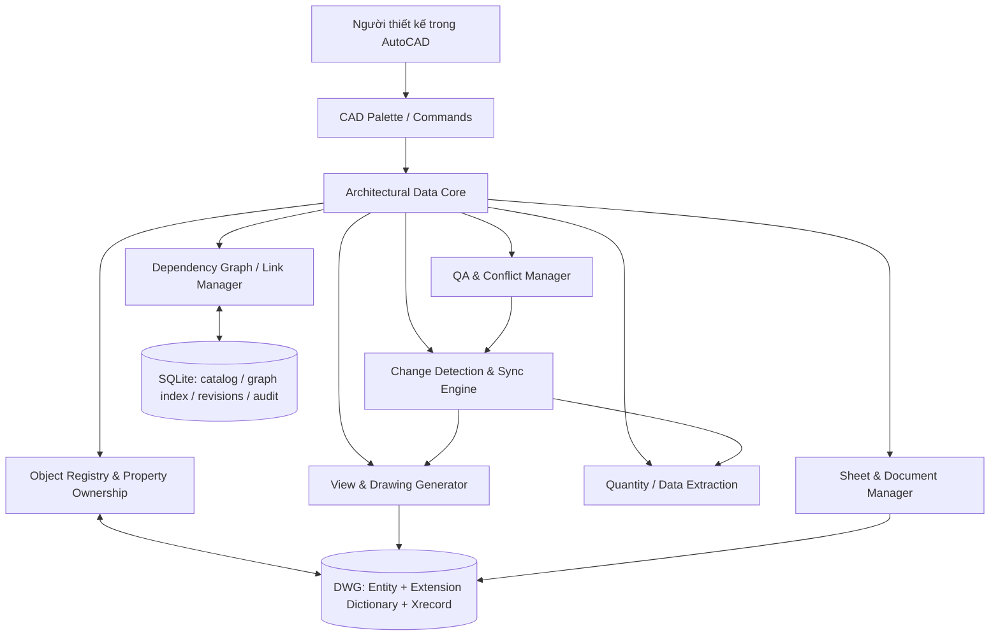
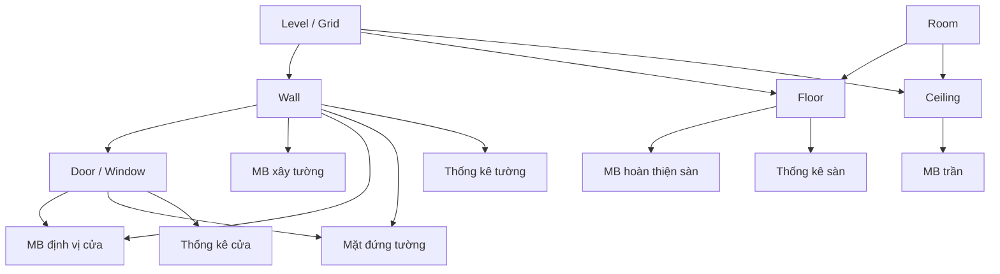
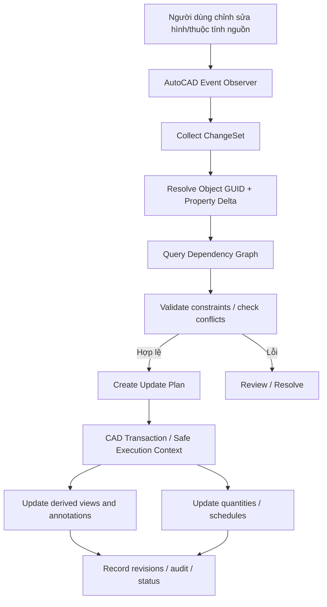
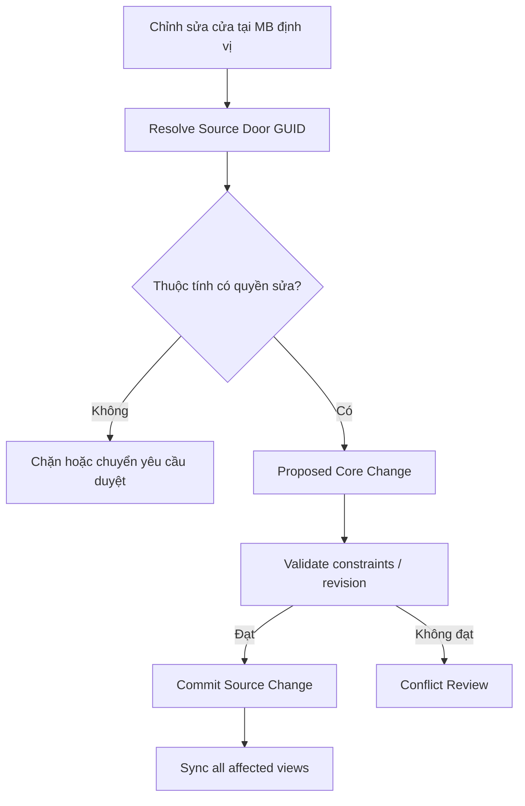
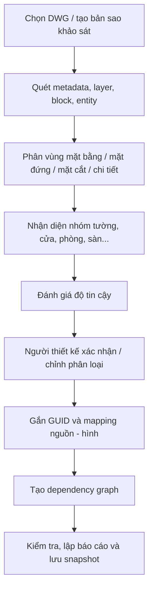
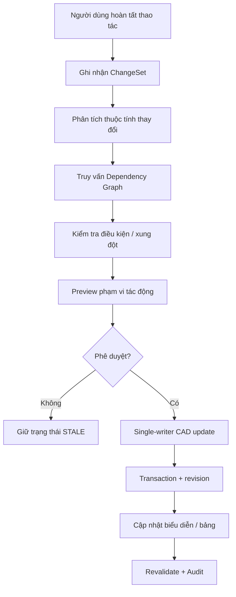

# PLAN AUTOCAD — HỆ THỐNG TRIỂN KHAI BẢN VẼ KIẾN TRÚC ĐỒNG BỘ

> **Tên tài liệu:** `PLAN_Autocad_v0.2.md`  
> **Phiên bản:** 0.2 — Kế hoạch kiến trúc, lộ trình 5 bước và khảo sát giải pháp tương tự  
> **Ngày lập:** 19/11/2026  
> **Dự án:** Phát triển chuỗi Add-in AutoCAD triển khai chi tiết kiến trúc  
> **Trạng thái:** Bản kế hoạch đề xuất; cần xác thực chi tiết bằng kiểm kê dữ liệu hai bản vẽ mẫu trước khi chốt thiết kế kỹ thuật.

---

## 0. Tóm tắt điều hành

### 0.1. Tầm nhìn

Xây dựng hệ thống **Architectural Data Core + Drawing Dependency System** vận hành bên trong AutoCAD, cho phép:

1. Quản lý các đối tượng kiến trúc (tầng, trục, cao độ, phòng, tường, cửa, sàn, trần, thiết bị, vật liệu...) như **dữ liệu có định danh và quan hệ**, không chỉ là đường nét CAD.
2. Sử dụng mặt bằng kiến trúc, mặt bằng nội thất, mặt đứng và mặt cắt như **các nguồn nhập/chỉnh sửa dữ liệu lõi được phân quyền theo thuộc tính**.
3. Sinh và duy trì liên kết giữa bản vẽ lõi với mặt bằng xây tường, định vị cửa, hoàn thiện sàn, trần, mặt đứng nội thất, chi tiết cửa, WC, cầu thang, thống kê vật liệu và các bản vẽ triển khai khác.
4. Tự phát hiện thay đổi, tính phạm vi tác động, cập nhật **đúng bản vẽ/đối tượng phụ thuộc** thay vì vẽ lại toàn bộ hồ sơ.
5. Cho phép tra cứu, kiểm tra sai lệch, thống kê, xuất dữ liệu và quản lý trạng thái đồng bộ/phiên bản hồ sơ.
6. Tận dụng bản vẽ DWG đang có, gắn định danh và tái thiết lập liên kết có kiểm soát, hạn chế yêu cầu người thiết kế vẽ lại.

### 0.2. Ba nguyên tắc cốt lõi

- **Một cấu kiện — một định danh nghiệp vụ ổn định — nhiều hình biểu diễn.**
- **Một thuộc tính — một nguồn dữ liệu có thẩm quyền — nhiều nơi tiêu thụ.**
- **Một thay đổi — xác định quan hệ phụ thuộc — chỉ cập nhật thành phần chịu ảnh hưởng.**

### 0.3. Lựa chọn kiến trúc

**Chọn hướng B:** Nền tảng dữ liệu kiến trúc có liên kết, kết hợp chức năng tự động triển khai bản vẽ. Không chỉ xây các lệnh độc lập để sao chép hình, bởi sản phẩm đó không đảm bảo đồng bộ về sau.

### 0.4. Định hướng giai đoạn đầu

Chứng minh bằng một bộ thử nghiệm nhỏ: **mặt bằng nội thất/kiến trúc gốc → mặt bằng xây tường → mặt bằng định vị cửa → thống kê cửa và tường**, với các trường hợp di chuyển/sửa/xóa, Undo/Redo, lưu/mở lại DWG, kiểm tra sai lệch.

---

## 1. Nguồn khảo sát và trạng thái xác minh

### 1.1. Thư mục và hai file mẫu

Thư mục nguồn: `Plan Autocad/FILE MAU` trên Google Drive.  
- [Thư mục FILE MAU](https://drive.google.com/drive/folders/1DwVK_ag15vCofxjWfvlf1v5ydjMQkUcQ)
- [26-09-15_Nha Co Ha Chu Son.dwg](https://drive.google.com/file/d/1E2vguVHm1evaTjQLlWlP3WCv7yikDz5n/view)
- [24-10-28_NhaCongVuTinhUy.dwg](https://drive.google.com/file/d/1jXobWigDISfHp2YfwZu3-t8I_kMk8m7x/view)

| Thuộc tính | `26-09-15_Nha Co Ha Chu Son.dwg` | `24-10-28_NhaCongVuTinhUy.dwg` |
|---|---|---|
| Dung lượng xấp xỉ | 3,36 MB | 8,61 MB |
| Mã định dạng trong header | `AC1021` (DWG 2007) | `AC1024` (DWG 2010) |
| Metadata phần mềm lưu được nhận diện ở bước khảo sát trước | AutoCAD 2021 (cần kiểm tra lại bằng công cụ DWG) | AutoCAD 2021 (cần kiểm tra lại bằng công cụ DWG) |
| Đọc toàn bộ thực thể hình học và thuộc tính | **Chưa hoàn thành** | **Chưa hoàn thành** |
| Đọc chính xác danh mục bản vẽ/chi tiết trong DWG | **Chưa xác nhận** | **Chưa xác nhận** |

**Lưu ý về tính trung thực dữ liệu:** Những nội dung ở các mục 2–13 dưới đây là **phân tích nghiệp vụ, thiết kế đề xuất và kế hoạch kiểm thử**, không phải kết luận rằng mọi nhóm bản vẽ đã được nhìn thấy trong cả hai DWG. Bước kiểm kê DWG nguyên bản và đối chiếu hình in là một hạng mục bắt buộc của giai đoạn 0.

Một số chuỗi được nhận diện trong quá trình khảo sát file `24-10-28_NhaCongVuTinhUy.dwg`: `TENBANVE`, `KT-00`, `KT-01`, `TRUC`, `CAO_DO`, `COT_CAO_DO`, `01_COT_CAO_DO`, `01_LOAI_SAN`, `02_LOAI_SAN`, `TUONGXAY`, `VATLIEU`, `VITRI`, `CHITIET`, `Tang 2`, `1800X2000`, `750X2200`, `1430X1800`. Đây chỉ là **chuỗi dữ liệu**, chưa chắc là tên bản vẽ, block hay thông số thiết kế; phải xác thực trong AutoCAD.

### 1.2. Mục tiêu khảo sát sâu ở giai đoạn 0

Đối với **từng file**, phải kiểm kê:

- Metadata: phiên bản DWG, đơn vị, bản vẽ được lưu từ phần mềm nào, không gian tọa độ, tỷ lệ biểu diễn.
- Model Space, Paper Space/Layout, khung bản vẽ, viewport, tên bản vẽ, số hiệu, tỷ lệ, khu vực và tầng.
- Layer: tên, tính chất, số thực thể, vai trò kiến trúc, trùng lặp/không nhất quán.
- Block/Attribute/Dynamic Block: tên, số lượng, thuộc tính, điểm chèn, liên kết, cấu trúc lồng nhau.
- Line, Polyline, Arc, Circle, Hatch, Region, Dimension, Leader, Text, MText, Table, Xref, Field.
- Trục định vị, mốc cao độ, tường, cửa, sàn, trần, phòng, thiết bị, vật liệu, chi tiết.
- Thực thể lặp lại giữa các hình vẽ; đối tượng nào là bản vẽ gốc, bản sao tham chiếu, đối tượng dựng tay, đối tượng quản lý bằng block.
- Mối liên hệ thực tế giữa mặt bằng kiến trúc/nội thất và bản vẽ xây tường, cửa, sàn, trần, mặt đứng nội thất, chi tiết cấu tạo, thống kê.
- Rủi ro khi gán ID cho bản vẽ cũ: đối tượng chồng nét, block nổ, polyline hở, ký hiệu không theo tiêu chuẩn, text thay đổi nhưng hình không đổi.

**Đầu ra giai đoạn 0:**

1. `DWG_INVENTORY_01` và `DWG_INVENTORY_02` (thống kê đối tượng từng file).
2. `SHEET_CATALOG` (danh sách chính xác các bản vẽ, mã, tầng, tỷ lệ, phạm vi).
3. `ENTITY_CLASSIFICATION` (bản đồ layer/block/đối tượng và mức độ tin cậy phân loại).
4. `DEPENDENCY_MATRIX` (bản vẽ nguồn → bản vẽ tiêu thụ → thuộc tính liên kết).
5. `GAP_REPORT` (những dữ liệu chưa có hoặc không thể suy luận từ DWG 2D).
6. `MVP_SAMPLE_SET` (tập cấu kiện tường/cửa/phòng/sàn đại diện cho kiểm thử).

> Có thể dùng AutoCAD .NET API để xuất JSON/CSV/DXF và PDF để đối chiếu trực quan. Không kết luận các quan hệ tự động chỉ từ tên layer hoặc chuỗi text; mọi phép suy luận phải có mức độ tin cậy và bước xác nhận của người thiết kế.

---

## 2. Phân cấp dữ liệu trong hồ sơ triển khai kiến trúc

### 2.1. Cấp 1 — Bản vẽ và dữ liệu lõi

| Nguồn dữ liệu | Các thuộc tính do nguồn quản lý ưu tiên | Ghi chú |
|---|---|---|
| Hệ trục định vị | Tên trục, tọa độ, phương, khoảng cách | Nguồn neo hình học chung |
| Hệ cao độ/tầng | Cốt tầng, chiều cao tầng, cốt sàn, cốt trần | Kết hợp mặt cắt và mặt đứng |
| Mặt bằng kiến trúc | Ranh giới xây dựng, vị trí tường, cửa, cầu thang, không gian | Nguồn hình học chính cho phần kiến trúc |
| Mặt bằng bố trí nội thất | Công năng, ranh giới nội thất, vách ngăn, đồ đạc/thiết bị | Nguồn hình học chính với đối tượng nội thất |
| Mặt đứng kiến trúc | Tổ chức mặt ngoài, vị trí cửa theo phương đứng, vật liệu mặt đứng | Không chỉ là hình chiếu phát sinh |
| Mặt cắt kiến trúc | Quan hệ cao độ, chiều cao, cấu tạo sàn/trần/mái, vị trí ô mở | Nguồn quyết định thuộc tính phương đứng |
| Dữ liệu kết cấu liên kết | Vị trí cột, dầm, sàn kết cấu và khoảng không kỹ thuật | Không để mặt bằng nội thất tùy ý ghi đè |

**Quy tắc:** Không mặc định “mặt bằng nội thất sở hữu toàn bộ thuộc tính”. Phải quy định quyền sở hữu **theo thuộc tính**, ví dụ vị trí vách ngăn thuộc mặt bằng nội thất; cao độ đỉnh tường thuộc mô hình cấp/tầng hoặc mặt cắt; chiều rộng cửa có thể chỉnh ở bản vẽ định vị cửa nhưng ghi về đối tượng `Door` trung tâm nếu hợp lệ.

### 2.2. Cấp 2 — Bản vẽ triển khai phụ thuộc

| Bản vẽ đầu ra | Dữ liệu lấy từ đâu | Mức tự động hóa kỳ vọng | Ghi chú |
|---|---|---|---|
| Mặt bằng định vị xây tường | Tường, trục, cửa, tầng | Tự động | Phân loại tường mới/cũ/phá dỡ nếu có dữ liệu |
| Mặt bằng định vị cửa | Tường, cửa, trục | Tự động | Định vị theo đầu tường/trục/cạnh tham chiếu |
| Mặt bằng hoàn thiện sàn | Phòng, ranh giới sàn, vật liệu | Tự động theo dữ liệu | Có thể cần xử lý ranh giới đặc biệt |
| Mặt bằng định vị/cốt sàn | Trục, ranh giới, cao độ | Tự động theo dữ liệu | Tách cốt kết cấu và cốt hoàn thiện |
| Mặt bằng trần | Phòng, cốt trần, thiết kế trần | Bán tự động | Kiểu trần không tự suy ra từ mặt bằng |
| Mặt bằng lát gạch | Phòng, loại gạch, mạch lát, quy tắc lát | Bán tự động | Cần điểm gốc và chiều lát |
| Mặt bằng thiết bị | Phòng, nội thất, danh mục thiết bị | Bán tự động | Phụ thuộc chuyên ngành và thiết kế |
| Mặt bằng định vị nội thất | Đồ nội thất, trục, tường | Tự động | Liên kết điểm neo với phòng/tường |
| Mặt đứng triển khai tường | Tường, cửa, cao độ, vật liệu | Bán tự động | Cần view và phạm vi nhìn |
| Mặt đứng nội thất | Tường, đồ nội thất, hoàn thiện, cao độ | Bán tự động | Hình học phải có dữ liệu chiều cao |
| Chi tiết cửa | Loại cửa, kích thước, cấu tạo, thư viện mẫu | Tự động theo mẫu | Không đổi nếu chỉ dịch vị trí mà kích thước/loại không đổi |
| Chi tiết WC | Không gian, thiết bị, chống thấm, hoàn thiện | Bán tự động | Yêu cầu dữ liệu cấu tạo và chuyên ngành |
| Chi tiết cầu thang | Bậc, chiếu nghỉ, cao độ, kết cấu | Bán tự động | Cần kiểm tra quy tắc thiết kế |
| Chi tiết sàn | Cấu tạo nền, lớp hoàn thiện, cao độ | Tự động theo cấu tạo | Xử lý mẫu cấu tạo dạng tham số |
| Chi tiết trần | Kiểu trần, cốt, cấu tạo | Bán tự động | Phụ thuộc catalogue chi tiết |
| Chi tiết mái | Hình học, dốc, cấu tạo mái | Bán tự động | Có thể cần mô hình 3D/2.5D |
| Chi tiết ốp tường | Tường, vùng vật liệu, quy tắc chia mạch | Bán tự động | Không suy ra từ tường thuần 2D |

### 2.3. Cấp 3 — Thống kê và quản lý hồ sơ

| Đầu ra | Nguồn dữ liệu |
|---|---|
| Thống kê cửa đi/cửa sổ | `Door`, `Window`, `Type`, `Level`, `Room` |
| Thống kê tường | `Wall`, vật liệu, chiều dài, chiều cao, ô mở |
| Thống kê hoàn thiện sàn | `Room`/`Floor`, diện tích, lớp hoàn thiện |
| Thống kê hoàn thiện tường | Diện tích từng mặt tường, ô mở, vùng vật liệu |
| Thống kê trần | `Ceiling`, diện tích, cốt, loại |
| Thống kê thiết bị/nội thất | `Furniture`, `Equipment`, `Room` |
| Thống kê vật liệu | Quy tắc bóc tách từ đối tượng và lớp cấu tạo |
| Danh mục phòng | Mã phòng, tên, tầng, diện tích, công năng |
| Danh mục bản vẽ | `Drawing`, `Sheet`, mã, tên, trạng thái, phiên bản |
| Nhật ký thay đổi | `ChangeSet`, tác giả, thời gian, ảnh hưởng, phê duyệt |

---

## 3. Kiến trúc tổng thể



### 3.1. Trách nhiệm của từng lớp

1. **CAD UI / Commands:** Chọn vùng bản vẽ gốc, gán tầng, tạo ID, chọn view, kiểm tra/cập nhật liên kết, duyệt thay đổi, xem báo lỗi.
2. **Architectural Data Core:** Mô hình đối tượng kiến trúc độc lập với cách vẽ 2D; quy định thuộc tính, đơn vị, ràng buộc, quan hệ.
3. **Object Registry:** Ánh xạ `ObjectGuid ↔ DWG/FileGuid/Handle/Entity`; khôi phục sau mở lại, sao chép, gộp file.
4. **Dependency Graph:** Lưu cạnh phụ thuộc ở cấp đối tượng và thuộc tính; truy vấn đối tượng đầu ra bị ảnh hưởng.
5. **View Generator:** Dựng hình biểu diễn mặt bằng, mặt đứng, mặt cắt, chi tiết từ dữ liệu; quản lý tỷ lệ, điểm chèn, layer, hatch, dim, text.
6. **Sync Engine:** Phát hiện thay đổi, tạo tập thay đổi, kiểm tra xung đột, cập nhật theo thứ tự phụ thuộc, điều phối transaction.
7. **Quantity Engine:** Bóc tách dữ liệu có nguồn gốc, xử lý đơn vị và quy tắc trừ ô mở, xuất bảng và CSV/Excel/JSON theo nhu cầu.
8. **Drawing/Sheet Manager:** Mã bản vẽ, khung tên, Layout, trạng thái, phiên bản, phát hành PDF/DWG.
9. **QA:** Kiểm tra thiếu ID, liên kết gãy, dữ liệu thiếu, xung đột, bản vẽ lỗi thời.

### 3.2. Phân tách hai loại dữ liệu

- **Dữ liệu nghiệp vụ nguồn (authoritative):** Đối tượng `Wall`, `Door`, `Room`, `Level`... và các thuộc tính thiết kế phải được bảo toàn, có khả năng phục hồi.
- **Hình biểu diễn/đầu ra (derived):** Line/Polyline/Hatch/Block/Dim/Text có `ViewId`, `SourceObjectGuid`, `GeneratorVersion` và trạng thái sinh. Có thể tái tạo khi cần, nhưng phải bảo vệ các ghi chú và chỉnh sửa thủ công hợp lệ.

### 3.3. Ranh giới DWG và cơ sở dữ liệu ngoài

- Lưu **ID, metadata cốt lõi, bản liên kết cần thiết và version** trong DWG qua Extension Dictionary/Xrecord (hoặc cơ chế phù hợp API) để không mất danh tính khi di chuyển bản vẽ.
- Dùng **SQLite** để index nhanh toàn dự án, danh mục sheet, graph, audit, snapshot và bộ nhớ đệm; dữ liệu nguồn trong DWG và SQLite cần chính sách đồng bộ/khôi phục rõ ràng.
- Dùng `GUID`/`UUID` cho định danh nghiệp vụ, `DWG DocumentGuid` cho file/bản vẽ, `Handle` để tra cứu lại entity trong đúng file. Không dùng `ObjectId` phiên làm việc làm khóa bền vững.
- Định nghĩa `SchemaVersion`, `GeneratorVersion` và migration để mở rộng lâu dài.

---

## 4. Mô hình đối tượng kiến trúc

### 4.1. Danh mục thực thể

| Thực thể | Trường lõi | Quan hệ chủ yếu |
|---|---|---|
| `Project` | `Id`, tên, tiêu chuẩn, hệ tọa độ | `Building`, `Drawing` |
| `Building` | `Id`, mã, gốc tọa độ | `Level` |
| `Level` | `Id`, mã, cốt chuẩn, chiều cao | `Room`, `Wall`, `Floor`, `Ceiling` |
| `Grid` | `Id`, tên, tọa độ/phương | Neo định vị |
| `Room` | `Id`, mã, biên dạng, công năng | Tường, sàn, trần, thiết bị |
| `Wall` | `Id`, đường tim/mặt chuẩn, dài, dày, cao, loại | Cửa, ô mở, vật liệu |
| `Door` | `Id`, loại, rộng, cao, cao độ, điểm neo | Tường chủ (`HostWallId`) |
| `Window` | Tương tự `Door`, cao độ bậu | Tường chủ |
| `Floor` | Biên dạng, lớp cấu tạo, cốt | Phòng/tầng |
| `Ceiling` | Biên dạng, cốt, loại | Phòng/tầng |
| `Material` | `Id`, mã, tên, đơn vị, quy cách | Lớp cấu tạo và bề mặt |
| `Furniture` | `Id`, loại, kích thước, vị trí | Phòng và điểm neo |
| `View` | `Id`, loại, hệ tọa độ, phạm vi, tỷ lệ | Nhiều `ViewEntity` |
| `Drawing` | `Id`, mã, tên, tầng, nhóm | View, Sheet |
| `Sheet` | `Id`, số hiệu, khung tên, revision | Drawing/Layout |
| `Annotation` | Kiểu, mục tiêu neo, offset | Object/View |
| `ChangeSet` | Revision, tác động, nguồn, trạng thái | Graph/Sync/Audit |

### 4.2. Ví dụ: đối tượng tường

```json
{
  "schemaVersion": "1.0",
  "objectId": "<uuid-W-001>",
  "displayCode": "W-001",
  "type": "Wall",
  "levelId": "<uuid-LEVEL-02>",
  "geometry": {
    "baseline": [[0, 0], [4200, 0]],
    "thicknessMm": 110,
    "heightMm": 3300
  },
  "properties": {
    "wallType": "BRICK-110",
    "finishFaceA": "PAINT-01",
    "finishFaceB": "TILE-01"
  },
  "hostedObjectIds": ["<uuid-D-012>"],
  "revision": 12
}
```

### 4.3. Ví dụ: đối tượng cửa

```json
{
  "schemaVersion": "1.0",
  "objectId": "<uuid-D-012>",
  "displayCode": "D-012",
  "type": "Door",
  "hostWallId": "<uuid-W-001>",
  "levelId": "<uuid-LEVEL-02>",
  "widthMm": 900,
  "heightMm": 2200,
  "offsetFromWallStartMm": 1800,
  "sillElevationMm": 0,
  "doorType": "D1",
  "revision": 4
}
```

**Quy tắc neo:** Vị trí cửa được lưu theo tường chủ và khoảng cách dọc đường chuẩn; tọa độ XY hiển thị được suy ra từ hình học tường. Khi tường dịch chuyển/quay/đổi dài, hệ thống có thể cập nhật cửa đúng quan hệ, không phụ thuộc vào việc trùng tọa độ ban đầu.

### 4.4. Quyền sở hữu từng thuộc tính

| Thuộc tính | Nguồn chính thức | Bản vẽ được phép đề xuất sửa | Bản vẽ tiêu thụ |
|---|---|---|---|
| Đường chuẩn tường | Architectural Core/mặt bằng gốc | Bản vẽ xây tường (sau xác nhận) | Mặt bằng, mặt đứng, thống kê |
| Chiều cao tường | Cốt tầng + thiết kế mặt cắt | Mặt cắt (sau xác nhận) | Mặt đứng tường, khối lượng |
| Vị trí cửa theo tường | `Door`/mặt bằng gốc | Bản vẽ định vị cửa (sau xác nhận) | Xây tường, mặt đứng, thống kê |
| Chiều cao cửa | `DoorType` + thông số cửa | Mặt đứng/chi tiết cửa theo quyền | Ô chờ, chi tiết, thống kê |
| Cao độ sàn hoàn thiện | `Level`/`Floor` | Mặt bằng cốt sàn | Mặt cắt, chi tiết sàn |
| Loại hoàn thiện | `MaterialAssignment` | Bản vẽ hoàn thiện | Hatch, ghi chú, bóc tách |

Quy tắc xung đột phải ưu tiên nguồn chính thức, ràng buộc kỹ thuật và xác nhận người thiết kế; không áp dụng “thay đổi mới nhất luôn thắng”.

---

## 5. Quan hệ phụ thuộc và ví dụ đồng bộ

### 5.1. Quan hệ tổng thể



### 5.2. Tường `W-001`

Ví dụ giả định: dài 4200 mm, dày 110 mm, cao 3300 mm; hoàn thiện mặt A sơn, mặt B ốp gạch; có cửa D-012. Một đối tượng tường có thể sinh nhiều biểu diễn: mặt bằng gốc, xây tường, mặt đứng tường, chi tiết cấu tạo, kích thước, bảng diện tích.

**Khi đổi chiều dài:** xác định sự thay đổi của baseline, cập nhật hình tường, kiểm tra lại vị trí các cửa neo tường, ranh giới phòng/sàn/trần liên quan, kích thước định vị, diện tích/khối lượng. Không tự động thay mọi chi tiết khác nếu không có quan hệ phụ thuộc.

### 5.3. Cửa `D-012`

Ví dụ giả định: rộng 900 mm, cao 2200 mm, đặt cách đầu tường W-001 1800 mm.

| Thao tác | Bản vẽ/đầu ra cần xử lý |
|---|---|
| Dịch cửa 300 mm trên tường | Mặt bằng kiến trúc, xây tường, định vị cửa, mặt đứng và mặt cắt bị ảnh hưởng |
| Thay rộng cửa từ 900 lên 1000 mm | Các biểu diễn ô mở, ghi kích thước, mặt đứng, thống kê theo kích thước |
| Đổi mã loại cửa `D1` sang `D2` | Ký hiệu cửa, chi tiết cửa theo loại, bảng thống kê |
| Di chuyển cửa mà không đổi loại/kích thước | **Không tự động sửa cấu tạo chi tiết chuẩn của loại cửa** |
| Xóa cửa | Đóng/tạo lại lỗ tường theo chính sách, xóa/hủy liên kết hình biểu diễn liên quan, cập nhật thống kê |

### 5.4. Các loại cạnh trong Dependency Graph

- `HOSTED_BY`: cửa nằm trên tường.
- `LOCATED_ON_LEVEL`: đối tượng thuộc tầng.
- `BOUNDED_BY`: phòng được giới hạn bởi các tường/ranh giới.
- `DERIVED_FROM`: hình vẽ phụ thuộc dữ liệu nguồn.
- `ANNOTATES`: kích thước/ghi chú trỏ tới đối tượng.
- `USES_TYPE`: đối tượng dùng mẫu loại/chi tiết.
- `USES_MATERIAL`: lớp/bề mặt sử dụng vật liệu.
- `BELONGS_TO_VIEW`: hình vẽ thuộc mặt bằng/mặt đứng/mặt cắt cụ thể.
- `SCHEDULES`: bảng thống kê có tập đối tượng và quy tắc tính.

Mỗi cạnh nên ghi rõ: nguồn, đích, danh sách thuộc tính được theo dõi, phương pháp cập nhật, phiên bản schema, trạng thái và mức tin cậy (với liên kết nhập từ DWG cũ).

---

## 6. Cơ chế phát hiện và đồng bộ thay đổi

### 6.1. Chế độ A — Một chiều từ dữ liệu lõi (ưu tiên)



**Không trực tiếp chạy các thao tác sửa phức tạp trong callback `ObjectModified`.** Observer chỉ ghi nhận thay đổi và lập hàng đợi; bộ điều phối thực thi cập nhật sau khi AutoCAD ở ngữ cảnh phù hợp, có transaction và bảo vệ chống tái nhập/vòng lặp.

### 6.2. Chế độ B — Chỉnh sửa từ bản vẽ phụ thuộc (giai đoạn sau)



Cho phép sửa từ bản vẽ con chỉ với thuộc tính có nghĩa nghiệp vụ rõ. Không cho phép người dùng kéo bừa mọi Line ở bản vẽ chi tiết rồi suy ngược dữ liệu gốc một cách mơ hồ.

### 6.3. Thuật toán đồng bộ đề xuất

1. Nhận tập thay đổi `ChangeSet` sau lệnh CAD.
2. Xác định `SourceObjectGuid`, loại thay đổi (`Create/Update/Delete`) và `ChangedProperties`.
3. Xác minh `DocumentRevision`, phát hiện đối tượng đã bị xóa/Copy/Paste/Explode/Undo.
4. Duyệt đồ thị phụ thuộc theo đúng thuộc tính liên quan; tính tập view/annotation/schedule bị ảnh hưởng.
5. Tạo `UpdatePlan` gồm đối tượng sửa, hình cần tái sinh, đối tượng cần giữ nguyên và cảnh báo.
6. Kiểm tra vòng lặp phụ thuộc, xung đột chỉnh sửa thủ công, ràng buộc thiết kế; yêu cầu duyệt khi cần.
7. Thực thi cập nhật bằng transaction trong AutoCAD; đánh dấu nguồn cập nhật nội bộ để tránh tự kích hoạt lại vòng lặp.
8. Cập nhật revision/checksum/index, bảng thống kê và trạng thái từng bản vẽ.
9. Nếu lỗi: rollback transaction hoặc đánh dấu `SYNC_FAILED` có thể phục hồi; không để trạng thái “cập nhật thành công” giả.

### 6.4. Yêu cầu không thể thiếu

- **Idempotent:** Chạy đồng bộ lại không nhân đôi đối tượng.
- **Incremental:** Chỉ cập nhật phần bị ảnh hưởng; không làm mới toàn bộ bản vẽ mỗi lần.
- **Deterministic:** Cùng dữ liệu nguồn + version generator tạo kết quả tương đương.
- **Undo/Redo consistency:** Không tách lịch sử sửa nguồn khỏi trạng thái hình phụ thuộc.
- **Crash recovery:** Đóng/mở AutoCAD giữa lúc đang đồng bộ phải phát hiện trạng thái chưa hoàn tất.
- **Cycle prevention:** Không để graph tường ↔ cửa ↔ bản vẽ con tạo vòng lặp vô hạn.
- **Edit protection:** Phân biệt hình sinh tự động và chú thích/thể hiện đã chỉnh sửa thủ công có chủ đích.
- **Version fencing:** Nếu dữ liệu nguồn đổi trong lúc chuẩn bị cập nhật, bỏ kế hoạch cũ và tính lại.

---

## 7. Các module/Add-in cần phát triển

Nên tổ chức **một nền tảng chung + nhiều module DLL/namespace** để chia sẻ model, ID, schema, transaction, logging; không triển khai các add-in độc lập với nhiều cơ sở dữ liệu khác nhau.

| Mã | Module | Chức năng chính | Ưu tiên |
|---|---|---|---|
| `CAD.ProjectManager` | Dự án/tầng/hồ sơ | Khởi tạo dự án, công trình, tầng, mã bản vẽ | P0 |
| `CAD.ObjectManager` | Đối tượng/định danh | Gắn GUID, đọc/ghi metadata, ánh xạ entity | P0 |
| `CAD.ArchitecturalCore` | Dữ liệu kiến trúc | Tường, cửa, phòng, trục, cao độ, sàn... | P0 |
| `CAD.DrawingAnalyzer` | Phân tích DWG | Kiểm kê, phân loại, nhập file cũ | P0 |
| `CAD.DrawingLink` | Liên kết | Dependency graph, tìm nguồn/phụ thuộc | P0 |
| `CAD.SyncEngine` | Đồng bộ | ChangeSet, UpdatePlan, thực thi an toàn | P0 |
| `CAD.ViewGenerator` | Biểu diễn | Sinh MB xây tường, định vị cửa... | P0/P1 |
| `CAD.QuantityManager` | Thống kê | Cửa, tường, sàn, hoàn thiện, xuất dữ liệu | P1 |
| `CAD.DetailManager` | Chi tiết cấu tạo | Template/recipe, quản lý loại và biến thể | P1 |
| `CAD.SheetManager` | Quản lý bản vẽ | Mã, khung tên, trạng thái, version, phát hành | P1 |
| `CAD.QAManager` | Kiểm soát lỗi | Gãy liên kết, khác revision, dữ liệu thiếu | P1 |
| `CAD.BidirectionalEdit` | Sửa từ view phụ thuộc | Validate thuộc tính, xung đột, phản hồi | P2 |
| `CAD.CrossDwgLink` | Liên kết nhiều DWG | Truy vấn/đồng bộ nhiều file | P2 |

### 7.1. Công nghệ dự kiến

- **C# + AutoCAD .NET API:** lệnh, Palette UI, đối tượng DWG, transaction, event.
- **Extension Dictionary/Xrecord:** lưu định danh và metadata trên đối tượng; Named Objects Dictionary cho dữ liệu cấp tài liệu khi phù hợp.
- **SQLite:** graph index, registry, sheet catalog, lịch sử, caching, truy vấn/đối soát.
- **JSON Schema:** cấu trúc dữ liệu trung gian, recipe/generator, versioning, kiểm tra dữ liệu trước khi ghi.
- **CSV/Excel/JSON:** định dạng xuất dữ liệu; trong đó PDF/DWG là định dạng bàn giao hồ sơ.
- **Hệ thống template/recipe:** hình và chi tiết chuẩn có tham số, không hard-code từng mẫu vào lõi.

**Tương thích AutoCAD:** Xác định chính xác phiên bản AutoCAD mục tiêu và runtime .NET theo bộ API đi kèm phiên bản đó trước khi chọn framework/build target. Phần kế hoạch trước đây của dự án có ưu tiên AutoCAD 2021, nhưng cần xác nhận dải phiên bản được hỗ trợ thực tế trước khi code.

---

## 8. Drawing Manager — quản lý toàn bộ hồ sơ

### 8.1. Cây hồ sơ mục tiêu

```text
PROJECT: CÔNG TRÌNH A
├── BUILDING A
│   ├── LEVEL 01
│   │   ├── CORE
│   │   │   ├── Mặt bằng kiến trúc
│   │   │   ├── Mặt bằng nội thất
│   │   │   ├── Mặt đứng liên quan
│   │   │   └── Mặt cắt liên quan
│   │   ├── DERIVED PLANS
│   │   │   ├── Mặt bằng xây tường
│   │   │   ├── Mặt bằng định vị cửa
│   │   │   ├── Mặt bằng hoàn thiện sàn
│   │   │   ├── Mặt bằng trần
│   │   │   └── Mặt bằng định vị thiết bị
│   │   └── DETAILS
│   │       ├── Chi tiết cửa
│   │       ├── Chi tiết WC
│   │       └── Chi tiết hoàn thiện
│   ├── LEVEL 02
│   │   └── ...
│   └── SCHEDULES
│       ├── Cửa
│       ├── Tường
│       ├── Sàn / Trần
│       └── Vật liệu
└── DOCUMENT REGISTER
    ├── Danh mục bản vẽ
    ├── Trạng thái đồng bộ
    ├── Nhật ký thay đổi
    └── Phiên bản phát hành
```

### 8.2. Trạng thái bản vẽ

| Trạng thái | Ý nghĩa | Hành động |
|---|---|---|
| `UPDATED` | Trùng revision nguồn, không có lỗi | Có thể kiểm tra/phát hành |
| `OUTDATED` | Nguồn đã đổi, view chưa cập nhật | Đồng bộ lại |
| `CONFLICT` | Có thay đổi không thể tự hợp nhất | Duyệt xung đột |
| `MISSING_LINK` | Mất nguồn hoặc mất mục tiêu | Khôi phục/gán lại liên kết |
| `MANUAL_REVIEW` | Hạng mục cần kiểm tra chuyên môn | Người thiết kế xác nhận |
| `SYNC_FAILED` | Cập nhật thất bại | Xem nhật ký và thử lại |
| `APPROVED` | Đã duyệt tại revision cụ thể | Nếu nguồn đổi phải xét lại phê duyệt |

### 8.3. Giao diện đề xuất

Một Palette trong AutoCAD gồm:

- **Project Tree** — dự án/tầng/bản vẽ/chi tiết.
- **Object Inspector** — ID, nguồn, thuộc tính, đối tượng liên quan, người/chế độ sửa.
- **Dependency Explorer** — “đối tượng này xuất hiện ở đâu?”.
- **Change Preview** — trước/sau, số đối tượng chịu ảnh hưởng, xung đột.
- **Sync Status** — danh sách UPDATED/OUTDATED/CONFLICT.
- **Quantity & Export** — thống kê theo tầng/loại/vật liệu; xem nguồn số liệu.
- **Audit & Revisions** — lịch sử, người thay đổi, ngày, phiên bản phát hành.

---

## 9. Drawing Analyzer — tận dụng bản vẽ DWG có sẵn

### 9.1. Nguyên tắc

Không bắt buộc người dùng vẽ lại hồ sơ. Tuy nhiên, bản vẽ DWG thông thường có thể chỉ gồm đường nét không đủ ngữ nghĩa. Cần **quy trình chuyển đổi có xác nhận**, không áp dụng nhận diện hoàn toàn tự động mà không giám sát.

### 9.2. Pipeline nhập hồ sơ cũ



### 9.3. Bảng ánh xạ cần có

| Thuộc tính đầu vào | Vai trò | Mức xử lý |
|---|---|---|
| Layer | Dấu hiệu phân loại đối tượng | Gợi ý, không đủ để kết luận |
| Block name/attributes | Cửa, cao độ, ký hiệu trục, thiết bị | Ưu tiên đối chiếu thư viện |
| Polyline khép kín | Biên dạng phòng/sàn/vật liệu | Xác minh quan hệ hình học |
| Line song song | Tường | Cần kiểm tra giao cắt, bề dày, layer |
| Hatch | Vật liệu/vùng hoàn thiện | Chỉ tin cậy sau kiểm tra boundary |
| Dimension | Kích thước hiển thị | Không coi text override là số đo thật |
| Text/MText | Mã phòng, tên phòng, loại vật liệu | Chuẩn hóa và neo vào đối tượng |
| Xref | Nguồn tham chiếu | Kiểm tra path/version và quyền sửa |

### 9.4. Rủi ro đối với bản vẽ cũ

- Block cửa bị `EXPLODE` nên mất danh tính.
- Copy/Paste tạo đối tượng trùng GUID nếu không có handler tái cấp ID.
- Kích thước có `TextOverride`; không thể coi nhãn ghi là số liệu chính xác.
- Tường tách nhiều đoạn, line hở, chồng nét, lệch đơn vị.
- Một vị trí xuất hiện trong nhiều detail với tỷ lệ khác nhau.
- Các biểu diễn đã bị dịch/scale để trình bày trên Model Space.
- View không được định nghĩa bằng mặt phẳng cắt và hệ tọa độ, nên không thể cập nhật tự động ngay.

---

## 10. Trích xuất và kiểm soát dữ liệu

### 10.1. Bộ đầu ra cần hỗ trợ

1. **Danh mục đối tượng:** ID, loại, tầng, phòng, vị trí, chủ sở hữu, revision.
2. **Thống kê cửa:** mã, loại, rộng, cao, số lượng, tầng, phòng, vật liệu nếu có.
3. **Thống kê tường:** loại, chiều dài, dày, cao, diện tích từng mặt, diện tích ô mở, diện tích hoàn thiện.
4. **Thống kê sàn:** phòng, diện tích, cấu tạo, vật liệu, cốt hoàn thiện.
5. **Thống kê trần:** diện tích, cốt trần, loại, vật liệu.
6. **Danh mục bản vẽ:** mã, tên, view, tầng, revision, trạng thái.
7. **Báo cáo thay đổi:** nguồn nào đổi, những view/khối lượng nào bị tác động.
8. **Báo cáo QA:** liên kết gãy, đối tượng thiếu thuộc tính, lỗi dữ liệu, mặt bằng chưa đồng bộ.

### 10.2. Quy tắc truy xuất số liệu

Mỗi ô số liệu phải truy ngược được đến:

`ProjectId → SourceObjectId(s) → Rule/FormulaVersion → Units → ResultRevision`

Ví dụ diện tích sơn tường phải ghi rõ quy tắc trừ ô mở, số mặt tường, chiều cao áp dụng, vùng vật liệu, và làm tròn. Không nên phát hành số liệu chỉ lấy từ Hatch nếu chưa đảm bảo biên dạng phù hợp.

---

## 11. Lộ trình phát triển

| Giai đoạn | Nội dung | Deliverable | Điều kiện chuyển giai đoạn |
|---|---|---|---|
| **0 — Survey** | Đọc đủ 2 DWG mẫu, đối chiếu PDF/DXF, phân loại bản vẽ/đối tượng | Inventory, sheet catalog, dependency matrix | Có danh mục thực tế và bộ mẫu kiểm thử |
| **1 — Foundation** | Core schema, GUID, DWG metadata, SQLite index, xử lý Undo/Redo | `CAD.ObjectManager` và database v1 | Lưu/mở lại và sao chép không trùng ID |
| **2 — Architecture Model** | Level, Grid, Room, Wall, Door/Window | `ArchitecturalCore` v1 | Dữ liệu nguồn có thể tra cứu/sửa chính xác |
| **3 — Links** | Quan hệ host/derived, graph, source/view mapping | `DrawingLink` v1 | Truy vấn tác động đến đúng view |
| **4 — Sync MVP** | Event observer, ChangeSet, UpdatePlan, transaction | `SyncEngine` v1 | Tất cả test MVP một chiều đạt |
| **5 — View Generators** | MB xây tường, định vị cửa, annotation | `ViewGenerator` v1 | Sinh lại có tính idempotent |
| **6 — Data Extraction** | Thống kê cửa/tường, xuất CSV/JSON | `QuantityManager` v1 | Số liệu khớp dữ liệu nguồn |
| **7 — Document & QA** | Status, sheet tree, conflict, revision | `DrawingManager` và `QAManager` | Phát hiện được các bản vẽ lỗi thời |
| **8 — Advanced** | Sàn/trần/mặt đứng/chi tiết thư viện | Modules nâng cao | Kiểm thử từng loại chi tiết |
| **9 — Bidirectional / Multi-DWG** | Chỉnh từ view con; liên kết nhiều DWG | Nâng cấp hệ thống | Kiểm soát quyền sửa và xung đột |

### 11.1. MVP đề xuất

**Phạm vi:** một tầng và một tập bản vẽ gốc chứa các tường, cửa đại diện; đầu ra là MB xây tường, MB định vị cửa và hai bảng thống kê.

**Luồng minh họa:**

1. Nhập/tạo `W-001` (tường) và `D-012` (cửa trên tường).
2. Sinh các biểu diễn đầu ra và gán link tới đối tượng nguồn.
3. Dịch tường → thay đổi vị trí hình phụ thuộc và vị trí cửa theo quy tắc neo.
4. Dịch cửa 300 mm → cập nhật MB định vị và ô mở; không sửa chi tiết loại cửa nếu không thay đổi loại/kích thước.
5. Đổi cửa 900 → 1000 mm → cập nhật ô mở, kích thước và thống kê.
6. Xóa cửa → thu hồi hoặc đánh dấu orphan các hình phụ thuộc, tính lại thống kê.
7. Undo/Redo → đồng bộ lại trạng thái đúng với thao tác hiện hành.
8. Save/Close/Open → mọi ID và link vẫn tìm lại được.
9. Thay đổi thủ công hình được sinh → đánh dấu conflict hoặc khôi phục theo chính sách được chọn.

---

## 12. Tiêu chí nghiệm thu và kiểm thử

### 12.1. Functional Acceptance

- [ ] Mỗi đối tượng nghiệp vụ có `GUID` duy nhất trong phạm vi dự án.
- [ ] Dữ liệu thuộc tính không mất sau đóng và mở lại DWG.
- [ ] Cửa biết tường chủ và có điểm neo ổn định khi tường di chuyển.
- [ ] Truy vấn “xem các bản vẽ đang dùng tường/cửa này” trả đúng danh sách.
- [ ] Sửa nguồn chỉ cập nhật view bị ảnh hưởng; view độc lập không đổi.
- [ ] Không sinh hình trùng lặp khi bấm `Sync` nhiều lần.
- [ ] Xóa nguồn xử lý liên kết đích đúng trạng thái.
- [ ] Copy/Paste, Move, Rotate, Stretch, Undo/Redo, Save/Reload không làm sai graph.
- [ ] Bản vẽ con bị sửa tay được phát hiện trước khi bị ghi đè.
- [ ] Thống kê có nguồn truy vết và quy tắc tính rõ ràng.
- [ ] Bảng trạng thái hiển thị `UPDATED`, `OUTDATED`, `CONFLICT`, `MISSING_LINK`, `SYNC_FAILED` chính xác.
- [ ] Có log và khả năng phục hồi khi lỗi transaction/crash.

### 12.2. Non-functional Acceptance

- **Hiệu năng:** định nghĩa bộ test theo số lượng tường/cửa/đồ họa thực tế lấy từ hai DWG khảo sát; ghi benchmark trước khi cam kết ngưỡng thời gian.
- **Ổn định:** không khóa UI lâu; không để transaction dang dở; không phá DWG gốc.
- **Tương thích:** chốt matrix AutoCAD version + .NET runtime + platform x64; kiểm tra các object custom/proxy.
- **Dễ bảo trì:** schema migration, generator version, log, unit tests, integration tests trong AutoCAD.
- **Dữ liệu:** sao lưu DWG, snapshot DB, transaction log và quy trình phục hồi khi lệch giữa DWG/SQLite.

### 12.3. Những ca test đặc biệt

| Trường hợp | Kỳ vọng |
|---|---|
| Copy đối tượng đã có GUID | Cấp ID mới hoặc liên kết bản sao theo chính sách, không tự trùng |
| Explode block thuộc biểu diễn sinh | Cảnh báo mất liên kết/đánh dấu dirty |
| Xref không tìm thấy | `MISSING_LINK`, không xóa dữ liệu nguồn |
| Thay đổi đơn vị file | Cảnh báo, chuẩn hóa, không âm thầm scale sai |
| Thay đổi chiều cao tầng | Chỉ cập nhật dữ liệu đứng có liên quan |
| Thay đổi vật liệu tường | Cập nhật hatch/chú thích/thống kê, không di chuyển tường |
| Sửa biểu diễn con và nguồn cùng lúc | `CONFLICT`, yêu cầu duyệt theo quyền sở hữu |
| Lưu khi sync dở | Có thể kiểm tra/khôi phục hoặc sync lại an toàn |
| Người dùng Undo | Registry/index và trạng thái view khớp DWG |

---

## 13. Rủi ro và giải pháp

| Rủi ro | Hệ quả | Hướng giải quyết |
|---|---|---|
| DWG cũ thiếu ngữ nghĩa | Nhận diện nhầm tường/cửa | Quy trình phân loại bán tự động và xác nhận |
| Không xác định nguồn thuộc tính | Xung đột dữ liệu | Quy tắc sở hữu và kiểm soát quyền sửa |
| Tự cập nhật trong event callback | Vòng lặp/lỗi CAD | ChangeSet queue + transaction an toàn |
| Gán ID theo `ObjectId` | Mất link sau phiên làm việc | Dùng GUID + DocumentGuid + Handle mapping |
| Sao chép block/hình | Trùng GUID | Chính sách clone, kiểm tra registry khi nhập/copy |
| Người dùng sửa trực tiếp hình sinh | Lệch nguồn–đích | Dirty detection, manual review, protected layers |
| Dữ liệu ở SQLite nhưng mất DWG | Không thể tái tạo dự án | Metadata bền vững trong DWG + backup/index rebuild |
| Chi tiết không đủ dữ liệu 2D | Tự động sinh sai cấu tạo | Dùng template/recipe và yêu cầu thông số bổ sung |
| File nhiều bản vẽ trong Model Space | Khó xác định view độc lập | Tạo `ViewRegion` riêng và hệ tọa độ nội bộ |
| Khác phiên bản DWG/API | Plugin không tương thích | Matrix support và test theo từng AutoCAD version |

---

## 14. Đề xuất tổ chức mã nguồn

```text
AutoCAD-Architecture-System/
├── docs/
│   ├── PLAN_Autocad.md
│   ├── DWG_INVENTORY_01.md
│   ├── DWG_INVENTORY_02.md
│   ├── DEPENDENCY_MATRIX.md
│   ├── DATA_SCHEMA.md
│   └── TEST_PLAN.md
├── src/
│   ├── Cad.Addin.Host/              # Commands / Palette / AutoCAD API
│   ├── Cad.Core.Contracts/          # DTOs, interfaces, schemas
│   ├── Cad.ArchitecturalCore/        # Domain model
│   ├── Cad.ObjectRegistry/          # GUID + entity mapping
│   ├── Cad.DrawingAnalyzer/         # DWG import / classification
│   ├── Cad.DependencyGraph/         # Object/property dependencies
│   ├── Cad.SyncEngine/              # ChangeSet / UpdatePlan
│   ├── Cad.ViewGenerators/          # Plan/elevation/section/detail
│   ├── Cad.QuantityEngine/          # Measurement and schedules
│   ├── Cad.DocumentManager/         # Sheets, revisions, publication
│   └── Cad.Persistence/             # DWG metadata + SQLite
├── templates/
│   ├── doors/
│   ├── walls/
│   ├── floors/
│   └── annotation/
├── tests/
│   ├── unit/
│   └── integration-autocad/
└── samples/
    └── FILE_MAU_READ_ONLY/
```

**Nguyên tắc triển khai:** Dữ liệu mẫu gốc là tài sản khảo sát; chỉ thao tác trên bản sao khi phát triển/test, tránh ghi đè hai DWG nguồn.

---

## 15. Sơ đồ hành trình phát triển

```mermaid
flowchart LR
    S0[0. Đọc thật 2 DWG] --> S1[1. Object GUID + Metadata]
    S1 --> S2[2. Architectural Data Core]
    S2 --> S3[3. Dependency Graph]
    S3 --> S4[4. Sync Engine]
    S4 --> S5[5. MB xây tường + định vị cửa]
    S5 --> S6[6. Thống kê + QA]
    S6 --> S7[7. Drawing/Sheet Manager]
    S7 --> S8[8. Chi tiết nâng cao]
    S8 --> S9[9. Hai chiều + nhiều DWG]
```



### 15.1. Các quyết định cần chốt sau giai đoạn 0

1. Các bản vẽ mẫu thực tế đang được bố trí trong Model Space hay Layout, và cách chia vùng bản vẽ như thế nào.
2. Đâu là bản vẽ nguồn có thẩm quyền cho từng nhóm thuộc tính.
3. Tên/layer/block/kiểu kích thước có ổn định và dùng được cho nhận diện không.
4. Với hồ sơ có các mặt đứng/mặt cắt vẽ tay, nhóm nào có thể chuyển thành view phụ thuộc ở MVP.
5. Bản vẽ chi tiết sẽ được sinh mới, nhập mẫu có tham số, hay gán liên kết cho chi tiết cũ.
6. Có cần kết nối hệ thống Add-in này với nền tảng MCP/Template Library hiện có của dự án không (nên nối ở ranh giới dữ liệu, không để AI là điều kiện bắt buộc để đồng bộ CAD).
7. Dải phiên bản AutoCAD cần hỗ trợ và quy trình triển khai plugin trong môi trường sản xuất.

---

## 16. Kết luận và đề xuất ưu tiên

Trọng tâm không phải liên kết trực tiếp các đường Line/Polyline giống nhau giữa các bản vẽ. Trọng tâm là **gắn ngữ nghĩa và định danh đối tượng kiến trúc**, tạo **quan hệ phụ thuộc theo thuộc tính**, và xem mỗi bản vẽ là một cách biểu diễn của cùng một hệ dữ liệu.

**Đề xuất thứ tự thực hiện không thay đổi:**

1. **Kiểm kê đầy đủ 2 DWG mẫu** để không thiết kế phần mềm dựa trên giả định sai về hồ sơ thực tế.
2. **Làm chắc Object Registry + Architectural Core** trước khi viết generator chi tiết.
3. **Chứng minh vòng đồng bộ tường/cửa** trong một DWG, với lưu/mở lại, Undo/Redo và kiểm soát conflict.
4. **Mở rộng sang sàn/trần/mặt đứng/chi tiết và thống kê** bằng các module dùng cùng nguồn dữ liệu.
5. **Sau cùng** mới triển khai đồng bộ hai chiều rộng và liên kết nhiều file DWG.

Nếu hoàn thành đúng theo cấu trúc này, hệ thống sẽ trở thành một nền tảng **triển khai — quản lý — kiểm tra — trích xuất** hồ sơ kiến trúc thay vì chỉ là bộ lệnh CAD tự động hóa rời rạc.

---

## Phụ lục A — Tài liệu kỹ thuật tham khảo

- Autodesk AutoCAD .NET API / ObjectARX Managed Developer's Guide: https://help.autodesk.com/
- AutoCAD Xrecord / Extension Dictionary: dữ liệu gắn với đối tượng DWG.
- AutoCAD Document/Database Events: quan sát các thay đổi thực thể.
- AutoCAD ObjectId/Handle: quy tắc dùng định danh trong phạm vi DWG và phiên làm việc.

## Phụ lục B — Quy ước tài liệu

- **Đã xác minh:** thông tin được đọc trực tiếp qua công cụ và có thể đối chiếu lại.
- **Nhận diện sơ bộ:** chuỗi dữ liệu/metadata đã thấy nhưng chưa khẳng định vai trò nghiệp vụ.
- **Đề xuất:** kiến trúc, mô hình hoặc quy trình cần được thử nghiệm.
- **Bắt buộc kiểm tra:** kết luận chỉ được đưa ra sau bước mở và kiểm kê đúng đối tượng DWG hoặc xác nhận của người thiết kế.

---

## 17. Khảo sát giải pháp tham chiếu (bổ sung ngày 21/11/2026)

> **Phạm vi:** Khảo sát tài liệu chính thức của Autodesk, CADprofi và Bricsys để bổ sung tính năng cho dự án; đây là **nghiên cứu sản phẩm**, không phải chứng nhận đã chạy thử các phần mềm này. Các tính năng được gợi ý là yêu cầu thiết kế của hệ thống mới, **không có nghĩa các phần mềm tham khảo tự động tương thích hoặc chia sẻ được dữ liệu nội bộ với Add-in mới**.

### 17.1. Bảng so sánh

| Giải pháp | Điểm đã được nhà cung cấp công bố | Bài học để áp dụng | Giới hạn khi vận dụng |
|---|---|---|---|
| **AutoCAD Architecture Toolset** | Đối tượng tường/cửa/cửa sổ thông minh; ô mở và kết thúc tường được điều chỉnh khi thêm đối tượng; hệ thống style, display representation, Project Navigator; property sets và schedule tags | `Wall`/`Door` có quan hệ host–opening, thư viện style, nhiều cách hiển thị và bản vẽ được quản lý theo cấu trúc | Các đối tượng AEC của AutoCAD Architecture không tương đương với Line/Polyline của AutoCAD thường; cần xác minh loại AutoCAD đang sử dụng |
| **CADprofi Architectural** | Vẽ tường một/nhiều lớp, cửa có tham số, tự phát hiện chiều dày tường trong một số điều kiện, đánh số cấu kiện và xuất thống kê nhiều định dạng | Module tham số theo hạng mục, công cụ chèn nhanh, thư viện cấu kiện, tự đánh mã và xuất CSV/XLS/JSON | Mức độ nhận diện phụ thuộc hình học và quy tắc; không mặc định nhập mọi bản vẽ cũ không cần sửa |
| **BricsCAD BIM** | Phân loại khối 3D thành đối tượng xây dựng với BIMIFY; tạo/cập nhật hình chiếu, nhãn và bảng thống kê từ dữ liệu BIM | Hệ nhận diện bán tự động kèm xác nhận; `View` được sinh từ dữ liệu, phát hiện hình chiếu lỗi thời; nhãn bám đối tượng | Đây là nền tảng CAD/BIM độc lập; BIMIFY nhắm vào khối **3D**, không nên suy diễn khả năng tự hiểu bản vẽ 2D của chúng ta |
| **AutoCAD Data Extraction / Sheet Set Manager** | Trích xuất thuộc tính block, thông báo bảng dữ liệu không còn cập nhật; quản lý và phát hành tập sheet | Tận dụng công cụ gốc khi phù hợp; tích hợp cập nhật bảng và quản lý sheet thay vì viết lại mọi thứ | Không tự tạo toàn bộ quan hệ phụ thuộc 2D giữa các hình biểu diễn tường/cửa |

**Nguồn gốc và kiểm chứng:** xem mục 23 (liên kết tới tài liệu hãng, truy cập ngày 21/11/2026).

### 17.2. Danh mục tính năng được bổ sung sau nghiên cứu

**A. Kiểu cấu kiện tham số (Style Catalog):** `WALL_STYLE`, `DOOR_STYLE` lưu vật liệu, lớp cấu tạo, chiều dày, cách hiện thị, quy ước nhãn và bảng thống kê. Khi sửa style, xác định các đối tượng dùng style đó và đề xuất cập nhật. Nguồn tham khảo: AutoCAD Architecture và CADprofi.

**B. Quan hệ tường–cửa (Host/Opening):** cửa biết `hostWallId`, offset từ đầu tường, chiều rộng/cao, phía mở, cốt bậu/lintel; ô mở là **dữ liệu liên kết**, không phải khoét Line độc lập. Khi cửa thay đổi, ô mở và bản vẽ định vị chịu ảnh hưởng được cập nhật. Nguồn: AutoCAD Architecture.

**C. Nối tường thông minh (Wall Cleanup):** sau khi cơ chế tường thẳng ổn định, thêm giao L/T/X, ưu tiên lớp tường và cảnh báo nút nối không hợp lệ. Phải có bước xem trước và can thiệp thủ công. Nguồn: AutoCAD Architecture wall cleanup.

**D. Nhiều hình biểu diễn / mức thể hiện (View Representations):** một `Wall/ Door` có thể sinh nét khác nhau cho `PLAN_ARCH`, `PLAN_MASONRY`, `PLAN_DOOR`, `ELEVATION`, `SECTION`, `DETAIL`. Hình học và chú thích trong từng View có quyền sở hữu riêng. Nguồn: AutoCAD Architecture display system và BricsCAD BIM sections.

**E. Nhãn liên kết (Associative Tags):** mã tường/cửa, kích thước, vật liệu, số lượng hiển thị từ dữ liệu nguồn; tránh MText sao chép. Hỗ trợ quy tắc đánh số lại, khóa số hiệu được phê duyệt. Nguồn: AutoCAD Architecture schedule tags; BricsCAD BIMTAG.

**F. Thống kê theo thuộc tính (Schedules/Takeoff):** bảng cửa, bảng tường, diện tích hoàn thiện có bộ lọc tầng/khu vực/loại đối tượng; trích xuất CSV/Excel/JSON và bảng AutoCAD. Khi dữ liệu đổi, đánh dấu `STALE` và cho phép cập nhật. Nguồn: CADprofi, AutoCAD schedules/Data Extraction, BricsCAD schedules.

**G. Project Navigator và trạng thái hồ sơ:** cây dự án > tầng > mặt bằng gốc > bản vẽ phụ thuộc > sheet, tình trạng `UPDATED/STALE/CONFLICT/BROKEN/REVIEW_REQUIRED`, mở nhanh tới đối tượng và bản vẽ có lỗi. Nguồn: AutoCAD Architecture Project Navigator.

**H. Import bản vẽ cũ với mức tin cậy:** dự đoán Wall từ Line/Polyline/ Hatch, Door từ Block/hình học, nhưng chỉ **gợi ý**. Người dùng duyệt trước khi gán ID; lưu `confidence`, dấu vết thực thể nguồn và lý do nhận diện. Nguồn ý tưởng: BIMIFY, nhưng thiết kế riêng cho 2D.

**I. Impact Preview trước khi đồng bộ:** hiển thị `đối tượng bị sửa → thuộc tính đổi → View/Sheet/Bảng bị ảnh hưởng`; có `Preview/Apply/Skip/Rollback`; các chú thích được người dùng vẽ thủ công không bị xóa. Đây là năng lực khác biệt cần tự xây dựng.

**J. Thư viện mẫu và quy tắc theo dự án:** quản lý bản vẽ chi tiết cửa, loại tường, layer, hatch, dimstyle, textstyle, ký hiệu trục/cao độ; hỗ trợ thay đổi quy tắc mà không chỉnh sửa Core. Nguồn tham khảo: AutoCAD Architecture style/content browser và CADprofi library.

### 17.3. Các tính năng không đưa vào MVP

- Tự động dựng đầy đủ mô hình BIM 3D từ mọi bản vẽ 2D.
- Sinh mọi mặt đứng/mặt cắt kiến trúc chỉ từ mặt bằng khi chưa có cao độ/cấu tạo.
- Đồng bộ hai chiều tự do tại mọi vị trí vẽ, không kiểm tra xung đột.
- Tự nhận diện toàn bộ bản vẽ cũ không cần người thiết kế xác nhận.
- Đồng bộ nhiều DWG/máy cùng lúc trước khi cơ chế một DWG đủ ổn định.

Đây là những hướng mở rộng, không phải điều kiện bắt đầu giai đoạn 1.

## 18. Kế hoạch triển khai theo đúng 5 bước

### 18.0. Điều kiện khởi động (Gate 0)

**Phạm vi pilot:** một bản vẽ mặt bằng kiến trúc/nội thất được chọn trong hai DWG mẫu; 2 loại đối tượng `WALL` và `DOOR`; hai View phụ thuộc `PLAN_MASONRY` và `PLAN_DOOR`; một bảng cửa/tường. Không phá file mẫu gốc: làm việc trên bản sao có lưu lịch sử.

**Quyết định nền:** (1) đơn vị bản vẽ; (2) quy tắc trục/cao độ; (3) mô hình tường thẳng 2D + thuộc tính 2.5D; (4) xác định vùng bản vẽ; (5) quyền sửa dữ liệu gốc; (6) phạm vi đồng bộ khi người dùng chỉnh hình tự do.

**Hợp đồng chung áp dụng cho cả 5 bước:**

1. Một đối tượng logic có `globalGuid`, `type`, `schemaVersion`, `styleId`, `levelId`, `revision`, `geometry`, `properties`, `relations`.
2. Mỗi biểu diễn trong AutoCAD có `representationGuid`, `sourceGlobalGuid`, `viewId`, `rendererVersion`, `sourceRevision`.
3. Quy tắc dữ liệu phải phân biệt `source-owned`, `derived`, `manual-annotation`; phần người dùng làm thủ công không được xóa tùy tiện.
4. Các thay đổi phải có khả năng ghi nhật ký, kiểm tra lại, Undo/Redo và khôi phục liên kết sau khi mở lại file.
5. Module có thể tắt/bật mà **không xóa đối tượng**; khi tắt module, phần cập nhật liên quan được đánh dấu chờ xử lý nếu cần.

### 18.1. BƯỚC 1 — CAD DRAWING ANALYZER

**Mục tiêu:** đọc đúng cấu trúc DWG thực tế, biến hồ sơ hiện hữu thành dữ liệu có thể tra cứu, chưa tự đổi hình học.

**Phạm vi chức năng:**

- `ARC_SCAN`: đọc Model Space, Paper Space, Layout, Named Views, units, coordinate system cơ bản, layer, block definitions/references, dynamic block, attribute, Line, Polyline, Arc, Hatch, Dimension, Text/MText, Table, Xref và trạng thái file.
- `ARC_SHEETS`: tìm khung tên, vùng bản vẽ, mã hiệu bản vẽ/chi tiết; lưu danh sách `DrawingView` với phạm vi hình học đã được người dùng xác nhận. Tạo rule riêng cho cách tổ chức nhiều bản vẽ trong một Model Space.
- `ARC_CLASSIFY`: gợi ý đối tượng tường và cửa dựa trên layer + block + topology + text liên quan. Kèm mức tự tin và bằng chứng; **không nhận diện 100% tự động**.
- `ARC_REVIEW`: palette người dùng xem từng gợi ý, sửa loại, gộp/tách nhóm hình học, xác nhận vị trí và tầng.
- `ARC_REPORT`: xuất báo cáo inventory JSON/CSV + báo cáo chưa phân loại, đối tượng trùng/đứt, lỗi Xref.

**Đầu ra tối thiểu:** `drawing_inventory.json`, `view_catalog.json`, `classification_candidates.json`; bản tổng hợp thể hiện số lượng đối tượng theo loại/layer và vùng bản vẽ. Từng kết luận về hai DWG mẫu phải kèm bằng chứng `layout/handle/layer/block/extent`.

**Tiêu chí nghiệm thu:** không sửa bản vẽ nguồn; đọc lại cùng DWG cho cùng kết quả thống kê; nhận diện thủ công ít nhất một vùng mặt bằng và một tập Line/Polyline tường/cửa; báo cáo rõ phần chưa đọc được.

### 18.2. BƯỚC 2 — CAD OBJECT MANAGER

**Mục tiêu:** đăng ký và quản lý những đối tượng kiến trúc logic, không bắt buộc phải vẽ lại bản vẽ đã có.

**Module chung:** `ObjectRegistry`, `IdentityService`, `SchemaRegistry`, `PropertyStore`, `StyleCatalog`, `GeometryAdapter`, `MetadataPersistence`, `ValidationService`.

**MVP WALL:** tường thẳng có đường chuẩn, 2 đầu mút, hướng, chiều dày, cao độ đáy/đỉnh, tầng, loại/ vật liệu, danh sách thực thể CAD cấu thành, phiên bản. Hỗ trợ tường có hai đường song song từ bản vẽ cũ sau khi người dùng xác nhận.

**MVP DOOR:** cửa có `hostWallGuid`, chiều rộng/cao, khoảng cách dọc tường theo quy tắc cố định, hướng mở, mã loại, cao độ lắp đặt; hỗ trợ cửa dạng Block trong bản vẽ cũ hoặc cửa được Add-in tạo mới.

**Các lệnh:** `ARC_REGISTER_WALL`, `ARC_REGISTER_DOOR`, `ARC_PROPERTIES`, `ARC_STYLE`, `ARC_VALIDATE`, `ARC_FIND_OBJECT`.

**Lưu trữ:** `Extension Dictionary/Xrecord` trong DWG giữ metadata định danh tối thiểu, tham chiếu/phiên bản; chỉ mục SQLite có thể hỗ trợ tra cứu và lịch sử nhưng cần dựng lại được nếu mất cache. `ObjectId` chỉ dùng trong phiên AutoCAD; `Handle` là gợi ý tìm thực thể trong **cùng DWG**, không thay thế `GUID` nghiệp vụ.

**Tiêu chí nghiệm thu:** 100% đối tượng được đăng ký có GUID không trùng trong file kiểm thử; lưu/mở lại DWG vẫn tìm được đối tượng; xóa/clone/copy-paste không âm thầm tạo ra hai đối tượng nghiệp vụ cùng một GUID; không phát sinh sai lệch hình học khi đăng ký đối tượng.

### 18.3. BƯỚC 3 — CAD LINK MANAGER

**Mục tiêu:** hình thành đồ thị quan hệ, phân biệt đối tượng nguồn và hình biểu diễn trong các bản vẽ.

**Quan hệ chuẩn ban đầu:**

- `HOSTED_BY`: Door → Wall
- `DERIVED_FROM`: Opening → Door/Wall
- `DISPLAYED_IN`: Object → View
- `REPRESENTED_BY`: Object → CAD Entity Group/Block
- `TAGGED_BY`: Object → Label/Annotation
- `COUNTED_IN`: Object → Schedule
- `USES_STYLE`: Object → Style

**Một liên kết phải lưu:** `sourceGuid`, `targetGuid`, `relationType`, `propertyDependencies`, `sourceRevision`, `targetRevision`, `status`, `createdAt`. Kiểm tra vòng phụ thuộc, liên kết mất đích, sai View và duplicate khi copy.

**Các lệnh:** `ARC_LINK`, `ARC_UNLINK`, `ARC_IMPACT`, `ARC_TRACE`, `ARC_REPAIR_LINK`.

**Tiêu chí nghiệm thu:** từ một `Door` tìm được chính xác tường chủ, biểu diễn trên mặt bằng định vị, ký hiệu và dòng thống kê liên quan; khi mất một thực thể biểu diễn, hiển thị `BROKEN` thay vì tự tạo lung tung.

### 18.4. BƯỚC 4 — CAD SYNC ENGINE

**Mục tiêu:** cập nhật phần bị ảnh hưởng, không vẽ lại toàn bộ hồ sơ và không phá ghi chú thủ công.

**Pipeline kỹ thuật:**



**Điều kiện an toàn:**

- Theo dõi các sự kiện thay đổi nhưng không thực hiện thao tác CAD phức tạp ngay trong handler; gom `ChangeSet` rồi xử lý trong ngữ cảnh lệnh/giao dịch phù hợp.
- Chống vòng lặp khi chính Sync Engine sửa hình biểu diễn; mỗi thao tác có `jobId` và `sourceRevision`, không xử lý lại cùng thay đổi.
- Kiểm tra khác biệt giữa hai phiên bản trước khi ghi; với xung đột chuyển `CONFLICT` và yêu cầu người dùng quyết định.
- Hỗ trợ `Preview`, `Apply`, `Skip`, `Rollback/Undo`; phải kiểm tra các trường hợp thay đổi đang dang dở, lỗi transaction, ghi đè dữ liệu thủ công.
- Người dùng chỉ được sửa thuộc tính do mình có quyền quản lý; không mở đồng bộ hai chiều tự do trong MVP.

**Thứ tự thử nghiệm:**

1. Đổi kích thước `Door` 900→1000 mm → cập nhật ô mở, mặt bằng định vị, nhãn và thống kê.
2. Di chuyển `Door` dọc theo `Wall` → cập nhật các View vị trí; không thay đổi chi tiết cửa nếu `type/size` vẫn giữ nguyên.
3. Kéo dài `Wall` → giữ vị trí cửa theo `anchorRule`; phát cảnh báo nếu cửa vượt phạm vi tường.
4. Xóa `Door` → làm sạch liên kết/đánh dấu bảng cần cập nhật nhưng không xóa tay các ghi chú chưa xác định.
5. Undo/Redo, đóng/mở lại, copy/paste, tự xóa một thực thể thuộc nhóm tường, tắt module cửa trong khi tường thay đổi.

**Tiêu chí nghiệm thu:** kết quả đồng bộ đúng quan hệ; không có vòng đồng bộ vô tận; báo cáo thay đổi rõ ràng; không làm mất các layer hoặc ghi chú do người dùng tạo; sau lỗi có thể `rebuild index`/`repair links`.

### 18.5. BƯỚC 5 — CAD DRAWING GENERATOR

**Mục tiêu:** từ dữ liệu lõi và quy tắc biểu diễn, tạo được các bản vẽ triển khai và bảng thống kê có thể cập nhật.

**Generator MVP:**

1. `PLAN_MASONRY` — mặt bằng xây tường: nét tường, hatch theo style, ô mở cửa, kích thước xây.
2. `PLAN_DOOR` — mặt bằng định vị cửa: block/biểu tượng cửa, mã, kích thước và vị trí định vị theo trục/tường.
3. `DOOR_SCHEDULE` — thống kê cửa: mã, tầng, loại, kích thước, số lượng, ghi chú.
4. `WALL_SCHEDULE` — thống kê tường: mã, chiều dài, diện tích gộp, diện tích ô mở, diện tích ròng theo quy tắc xác định.

**Renderer:** có `RendererVersion` và `Layer/Dim/Hatch/TextStyle` theo từng View; **chỉ quản lý các thực thể do hệ thống sinh**, không xóa vùng bản vẽ tùy ý. Kiến trúc output phải hỗ trợ cùng DWG nhiều vùng Model Space, và mở rộng Layout/ nhiều DWG sau.

**Nghiệm thu:** tạo được một bộ bản vẽ nhỏ từ một mặt bằng được đăng ký, có liên kết nguồn; thay đổi lần hai chỉ cập nhật phần liên quan; số liệu bảng trùng với dữ liệu Core; có thể xuất CSV/Excel/JSON mà không cần người dùng nhập số lượng hai lần.

## 19. Ma trận ưu tiên tính năng

| Hạng mục | Tính năng | Ưu tiên | Giai đoạn |
|---|---|---|---|
| Khảo sát | Inventory DWG, Layer/Block/Layout/Named Views | **P0** | Bước 1 |
| Khảo sát | Chọn vùng mặt bằng, lưu phạm vi bản vẽ, xác nhận thủ công | **P0** | Bước 1 |
| Khảo sát | Gợi ý nhận diện Line/Polyline thành tường/cửa | **P0** (mức hỗ trợ) | Bước 1–2 |
| Dữ liệu | GUID + Xrecord + schemaVersion + validate/repair | **P0** | Bước 2 |
| Dữ liệu | Wall thẳng, Door host tường, style tối thiểu | **P0** | Bước 2 |
| Dữ liệu | Nhiều hình biểu diễn của một đối tượng | **P0** | Bước 3–5 |
| Liên kết | Dependency Graph + impact trace | **P0** | Bước 3 |
| Đồng bộ | Preview/Approve, STALE/CONFLICT, audit, Undo | **P0** | Bước 4 |
| Triển khai | Mặt bằng xây, định vị cửa, schedule cửa/tường | **P0** | Bước 5 |
| UI | Object Inspector, tìm đối tượng, Panel trạng thái | **P0** | Bước 2–5 |
| Tường | Nối giao L/T/X, lớp tường, cấu tạo | **P1** | Sau MVP |
| Cửa | Auto-numbering, library loại cửa, kiểm tra ô mở | **P1** | Sau MVP |
| Bản vẽ | View template, layer/dim/hatch theo tiêu chuẩn công ty | **P1** | Sau MVP |
| Hồ sơ | Project Navigator, Sheet Manager, phát hành PDF hàng loạt | **P1** | Sau MVP |
| Báo cáo | CSV/Excel/JSON, bộ lọc theo tầng và loại, change report | **P1** | Sau MVP |
| QA | Cảnh báo cửa vượt tường, mất liên kết, trùng ID, phòng hở | **P1** | Sau MVP |
| Mở rộng | Sàn, trần, phòng, cửa sổ, hoàn thiện, nội thất | **P2** | Sau MVP |
| Mở rộng | Chỉnh sửa hai chiều có quyền sở hữu thuộc tính | **P2** | Sau MVP |
| Mở rộng | Nhiều file DWG, Xref, cộng tác đa người dùng | **P2** | Sau MVP |
| Mở rộng | IFC/BIM3D/AI recognition tự động | **P3** | Dài hạn |

**Quy tắc ưu tiên:** không tăng phạm vi P0 chỉ vì một đối thủ đã có tính năng đó. Các tính năng P1–P3 chỉ được chuyển lên khi có nhu cầu kiểm chứng trên hai DWG mẫu hoặc yêu cầu sản xuất cụ thể.

## 20. Tổ chức code theo module và hợp đồng dữ liệu

```text
AutoCAD.ArchitecturalSuite/
├─ src/
│  ├─ Arch.Core/               # GUID, schema, domain model, change set
│  ├─ Arch.CadAdapter.Acad2021/# giao tiếp AutoCAD 2021 .NET Framework 4.8
│  ├─ Arch.DrawingAnalyzer/    # inventory, classification candidates
│  ├─ Arch.ObjectManager/      # registry, properties, styles
│  ├─ Arch.LinkManager/        # dependency graph, impact analysis
│  ├─ Arch.SyncEngine/         # deferred updates, transactions, audit
│  ├─ Arch.DrawingGenerator/   # View renderer + annotation
│  ├─ Arch.Modules.Wall/       # rules, topology, wall rendering
│  ├─ Arch.Modules.Door/       # host, opening, door rendering
│  ├─ Arch.Modules.Contracts/  # module registration + extension points
│  └─ Arch.UI/                 # AutoCAD palette, inspector, review
├─ tests/
│  ├─ Arch.Core.Tests/
│  ├─ Arch.Geometry.Tests/
│  ├─ Arch.Dependency.Tests/
│  ├─ Arch.Sync.Tests/
│  └─ Arch.Integration.AutoCAD/
├─ samples/                   # bản sao dữ liệu test, không thay DWG gốc
├─ schemas/                   # versioned JSON schemas/migration
├─ rules/                     # view rules, layer rules, styles
└─ docs/                      # ADR, manual, test cases, changelog
```

**Lưu ý phiên bản:** AutoCAD 2021 dùng .NET Framework 4.8 theo Autodesk; nếu hỗ trợ 2025+ phải có adapter/build tương ứng và kiểm chứng theo từng phiên bản/cập nhật .NET thay vì kỳ vọng một DLL chạy trên tất cả phiên bản. Mã domain càng ít phụ thuộc AutoCAD API càng tốt.

**Module contract tối thiểu:** `CanRecognize`, `Register`, `Validate`, `GetPropertySchema`, `ResolveDependencies`, `GenerateRepresentation`, `AnalyzeChanges`, `ApplyChanges`. Interface cụ thể sẽ được chốt sau khi kiểm kê hai file mẫu. Core không chứa `if(type==Wall)` hay `if(type==Door)` trong cơ chế lưu trữ/sync chung; các quy tắc do module đăng ký.

**Khái niệm dữ liệu:**

```json
{
  "globalGuid": "<GUID>",
  "type": "DOOR",
  "schemaVersion": 1,
  "styleId": "D1",
  "properties": {"widthMm": 900, "heightMm": 2200, "hostWallGuid": "<GUID>"},
  "relations": [{"type": "HOSTED_BY", "targetGuid": "<GUID>"}],
  "representations": [
    {"viewId": "PLAN_ARCH_02", "representationGuid": "<GUID>", "sourceRevision": 3},
    {"viewId": "PLAN_DOOR_02", "representationGuid": "<GUID>", "sourceRevision": 3}
  ],
  "revision": 3
}
```

Đây là **schema minh họa**, không phải schema cuối cùng. Các kiểu độ dài/cao độ cần ràng buộc đơn vị rõ ràng; trạng thái và lịch sử sẽ được chuẩn hóa ở DB riêng.

## 21. Kế hoạch sprint, người phụ trách và điều kiện chuyển giai đoạn

| Nhịp triển khai tham khảo | Hạng mục | Kết quả bắt buộc trước khi chuyển |
|---|---|---|
| Sprint 0 | Thiết lập repo, AutoCAD test, backup DWG, thống nhất quy ước | Có bộ test lặp lại, môi trường reproducible |
| Sprint 1–2 | Drawing Analyzer + nhận diện vùng bản vẽ | Xuất report trung thực từ hai DWG mẫu, có thể duyệt thủ công |
| Sprint 3–4 | Object Manager, Wall/ Door schemas, Xrecord | Đăng ký/đọc lại GUID và dữ liệu sau save/reopen |
| Sprint 5 | Link Manager + impact graph | Truy đúng tất cả mối liên kết của một cửa/tường mẫu |
| Sprint 6–7 | Sync Engine một chiều + review changes | Di chuyển/đổi kích thước/xóa/Undo/Redo không sai lệch |
| Sprint 8–9 | Generator cho xây tường, định vị cửa và bảng | Bộ bản vẽ nhỏ được sinh và tái cập nhật ổn định |
| Sprint 10 | UAT với người triển khai hồ sơ + tối ưu | Nhận diện được hạn chế, báo lỗi/repair rõ ràng, tài liệu UAT |

Sprint thường được dùng theo chu kỳ 1–2 tuần nhưng lịch thực tế phụ thuộc số người, độ phức tạp dữ liệu mẫu và khả năng chạy AutoCAD thật. Bảng này là **thứ tự và mốc kiểm thử**, không phải cam kết tiến độ.

**Vai trò tối thiểu:** 1 người thiết kế kiến trúc duyệt quy tắc nghiệp vụ; 1 lập trình viên C#/AutoCAD; 1 người kiểm thử (có thể kiêm); 1 người quyết định chuẩn dữ liệu/layer/style. Nếu một người kiêm nhiều vai trò, cần giữ tài liệu kiểm thử và tiêu chí nghiệm thu độc lập.

### 21.1. Những câu hỏi quyết định phải được chốt qua kiểm nghiệm

1. Các bản vẽ trong hai DWG mẫu nằm ở Model Space cùng tọa độ, có dùng nhiều vùng offset hay Layout/Xref không?
2. Tường thường thể hiện bằng 2 Line, Polyline kín, Hatch, Block hay hỗn hợp?
3. Cửa thể hiện bằng Block có attribute/dynamic block hay các nét rời?
4. Chiều cao và vị trí mở cửa lấy từ nguồn nào: mặt cắt/mặt đứng hay bảng cửa?
5. Số hiệu và quy cách layer/hatch/dim nào phải giữ nguyên để không làm thay đổi quy trình sản xuất hiện tại?
6. Khi người dùng sửa trực tiếp hình biểu diễn phụ thuộc, chọn `REJECT`, `MARK_MANUAL`, hay `PROPOSE_TO_CORE` cho từng thuộc tính?

Chỉ khi các câu hỏi được kiểm chứng trên hồ sơ mẫu, mới khóa schema và khởi công generator tương ứng.

## 22. Ma trận kiểm thử MVP và các rủi ro phải xử lý

| Test case | Dấu hiệu đạt | Khi lỗi phải làm gì |
|---|---|---|
| Scan không phá DWG | Hash bản test đầu vào không bị chỉnh | Dừng, rollback, tìm hàm đã ghi ngoài ý muốn |
| Import tường 2 Line | 1 WallGuid ↔ đúng nhóm thực thể, đúng chiều dày | Cho người dùng sửa mapping |
| Door host tường | Door bám đúng WallGuid và vị trí tương đối | Báo `HOST_INVALID` hoặc `OUTSIDE_WALL` |
| Chỉnh độ rộng cửa | Ô mở/nhãn/thống kê thay đổi; các phần khác không đổi | `CONFLICT` hoặc `STALE`, không ghi chồng |
| Di chuyển tường | Cửa thay đổi đúng anchor rule | Hiện preview và cho đổi quy tắc |
| Xóa/Undo/Redo | Graph và hình biểu diễn không còn link mồ côi | Rebuild index, repair link |
| Save/Reopen | GUID và version tồn tại, cache tái tạo | Tự tái lập từ Xrecord/metadata |
| Copy/Paste đối tượng | Không trùng GUID nghiệp vụ ngoài ý muốn | Yêu cầu xác nhận clone hoặc link instance |
| Tắt module | Không mất dữ liệu; cập nhật phụ thuộc được giữ trong hàng chờ | Đánh dấu STALE; cảnh báo bật lại |
| Người dùng vẽ thêm ghi chú | Đồng bộ không làm mất MText/Dim thủ công | Tách rõ managed entities và manual entities |
| Generate lại lần hai | Không trùng Block/Tag/Dim; kết quả idempotent | So sánh renderer version và GUID |
| DWG lỗi/lệch đơn vị | Không ghi cập nhật nguy hiểm | Chặn Apply, xuất diagnostic |

**Rủi ro lớn nhất:** (1) nhận dạng sai từ bản vẽ cũ; (2) đối tượng CAD bị phá nhóm bằng lệnh thủ công; (3) copy/paste/INSERT làm trùng metadata; (4) thay đổi tài liệu trong callback không an toàn; (5) phụ thuộc vòng và xung đột giữa bản vẽ; (6) generator xóa nhầm ghi chú; (7) phiên bản .NET/API không tương thích.

**Nguyên tắc bắt buộc:** mặc định `Review before Apply` cho mọi thay đổi ảnh hưởng nhiều bản vẽ trong MVP. `Auto Sync` chỉ kích hoạt cho một tập thao tác đã có kiểm thử và cơ chế rollback tin cậy.

## 23. Nguồn nghiên cứu tham khảo (truy cập ngày 21/11/2026)

**Sản phẩm và tính năng:**

1. Autodesk, *About Walls* — tường/cửa/ô mở tự điều chỉnh: https://help.autodesk.com/cloudhelp/2026/ENU/AutoCAD-Architecture/files/GUID-E7595DBB-BB79-4006-ADE5-17E4BD676110.htm
2. Autodesk, *About Project Navigator* — quản lý elements, constructs, views, sheets: https://help.autodesk.com/cloudhelp/2026/ENU/AutoCAD-Architecture/files/GUID-BDA8F9DF-B9C2-4014-B783-E12C9CAC90CD.htm
3. Autodesk, *About Display System* — các cách hiển thị theo View: https://help.autodesk.com/cloudhelp/2026/ENU/AutoCAD-Architecture/files/GUID-6C92CA39-53A5-4A22-9493-6E2033558CB6.htm
4. Autodesk, *About Schedule Table Terminology* — Property Set, Tag, Schedule: https://help.autodesk.com/cloudhelp/2026/ENU/AutoCAD-Architecture/files/GUID-77F8B132-6A45-483B-AB92-AD3BD5D47660.htm
5. Autodesk, *About Data Extraction* — trích xuất block properties và nhận biết bảng lỗi thời: https://help.autodesk.com/cloudhelp/2026/ENU/AutoCAD-Core/files/GUID-B0D32260-45E3-4643-B574-7F6C31579B68.htm
6. Autodesk, *Wall Cleanups and Priorities* — xử lý các nút giao tường: https://help.autodesk.com/cloudhelp/2025/ENU/AutoCAD-Architecture/files/GUID-A5F21978-FC03-4CFA-95F1-C027177A7A25.htm
7. CADprofi, *Architectural* — wall, doors, numbering, materials/specification export: https://www.cadprofi.com/main/en/products/cadprofi/cadprofi-architectural
8. CADprofi, *Doors and windows* — tự nhận diện chiều dày tường trong điều kiện hỗ trợ: https://ww.cadprofi.com/online-help/en/sys_arch_doors_windows.htm
9. Bricsys, *Using BIMIFY* — tự phân loại khối 3D và gán vị trí không gian: https://help.bricsys.com/en-us/document/bricscad-bim/design-assistance/using-bimify?version=V27
10. Bricsys, *BIMSECTIONUPDATE* — cập nhật hình chiếu và kích thước liên kết: https://help.bricsys.com/en-us/document/command-reference/b/bimsectionupdate-command?version=V27
11. Bricsys, *Schedules* — bảng thống kê theo thuộc tính: https://help.bricsys.com/en-us/document/bricscad-bim/design-documentation/schedules
12. Bricsys, *BIMTAG* — ký hiệu liên kết đối tượng: https://help.bricsys.com/en-us/document/command-reference/b/bimtag-command

**Công nghệ và an toàn:**

13. Autodesk, *Guidelines for Event Handlers (.NET)* — tránh thao tác không an toàn trong handler: https://help.autodesk.com/cloudhelp/2026/PTB/OARX-DevGuide-Managed/files/GUID-FE7D58D5-28A0-4C98-A876-D4D48F06D0B2.htm
14. Autodesk, *Managed .NET Compatibility (AutoCAD 2021)* — .NET Framework 4.8: https://help.autodesk.com/cloudhelp/2021/ENU/AutoCAD-Customization/files/GUID-A6C680F2-DE2E-418A-A182-E4884073338A.htm
15. Autodesk, *Managed .NET Compatibility (AutoCAD 2026)* — khác biệt .NET theo phiên bản cập nhật: https://help.autodesk.com/cloudhelp/2026/ENU/AutoCAD-Customization/files/GUID-A6C680F2-DE2E-418A-A182-E4884073338A.htm

## 24. Kết luận cập nhật

**Ưu tiên thiết kế theo thứ tự:** `Analyze legacy DWG → Register smart Wall/Door → Link Graph → Safe Incremental Sync → Generate plan & schedules`. Học từ đối thủ ở **năng lực sản phẩm và trải nghiệm**, không phụ thuộc vào cấu trúc code hay dữ liệu độc quyền của họ. Điểm khác biệt của hệ thống này là **ưu tiên hồi sinh dữ liệu liên kết từ hồ sơ AutoCAD 2D đã có, phân quyền dữ liệu theo thuộc tính và cập nhật nhiều bản vẽ chi tiết trong cùng DWG**.

> **Đề xuất MVP không đổi:** một tường + một cửa → mặt bằng xây tường, mặt bằng định vị cửa, bảng thống kê; triển khai thành công theo dõi `STALE/CONFLICT`, Undo/Redo và save/reopen rồi mới mở rộng sang sàn/trần/phòng và các chức năng P1.
